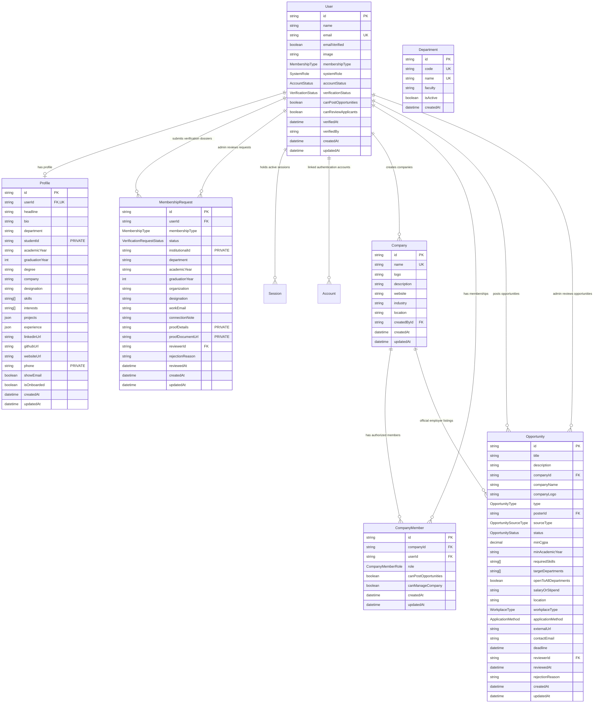

# UniCareer Community — Database Schema Specification

> **Architectural Status**: Stage 10 (Member Directory, Connections, and Referrals) Complete  
> **Database Engine**: PostgreSQL 16 on Neon via Prisma ORM 7.10.1 & `@prisma/adapter-pg`  
> **Models In Production**: `User`, `Profile`, `MembershipRequest`, `Company`, `CompanyMember`, `Department`, `Opportunity`, `OpportunityBookmark`, `Resume`, `Application`, `ApplicationStatusHistory`, `Post`, `Comment`, `PostReaction`, `PostBookmark`, `ContentReport`, `Connection`, `ReferralRequest`, `Session`, `Account`, `Verification`

---

## 1. Active Stage 6 Entity Relationships



---

## 2. Table Specifications

### `users`
| Column | Type | Constraints | Description |
| :--- | :--- | :--- | :--- |
| `id` | `VARCHAR(30)` | `PRIMARY KEY` (cuid) | Unique member identifier |
| `name` | `VARCHAR(100)` | `NOT NULL` | Full member display name |
| `email` | `VARCHAR(255)` | `NOT NULL`, `UNIQUE` | Unique institutional email |
| `emailVerified`| `BOOLEAN` | `DEFAULT false` | Verified via cryptographic email link |
| `image` | `TEXT` | `NULLABLE` | Avatar image URL |
| `membershipType` | `MembershipType` | `DEFAULT STUDENT` | `STUDENT`, `ALUMNI`, `FACULTY`, `STAFF`, `EMPLOYER`, `EXTERNAL_CONNECTION` |
| `systemRole` | `SystemRole` | `DEFAULT MEMBER` | `MEMBER`, `MODERATOR`, `ADMIN` (Decoupled from membership) |
| `accountStatus`| `AccountStatus`| `DEFAULT ACTIVE` | `ACTIVE`, `PENDING_VERIFICATION`, `SUSPENDED`, `DEACTIVATED` |
| `verificationStatus` | `VerificationStatus` | `DEFAULT PENDING` | `PENDING`, `VERIFIED`, `REJECTED`, `SUSPENDED` |
| `canPostOpportunities` | `BOOLEAN` | `DEFAULT false` | Posting clearance flag |
| `canReviewApplicants` | `BOOLEAN` | `DEFAULT false` | Candidate review clearance flag |
| `verifiedAt` | `TIMESTAMPTZ` | `NULLABLE` | Timestamp of admin verification |
| `verifiedBy` | `VARCHAR(30)` | `NULLABLE` | Admin user ID who validated credentials |
| `createdAt` | `TIMESTAMPTZ` | `DEFAULT now()` | Account creation timestamp |
| `updatedAt` | `TIMESTAMPTZ` | `AUTO UPDATE` | Last modified timestamp |

### `companies`
| Column | Type | Constraints | Description |
| :--- | :--- | :--- | :--- |
| `id` | `VARCHAR(30)` | `PRIMARY KEY` (cuid) | Unique company identifier |
| `name` | `VARCHAR(100)` | `NOT NULL`, `UNIQUE` | Registered legal or trade name |
| `logo` | `TEXT` | `NULLABLE` | Corporate emblem or logo URL |
| `description`| `TEXT` | `NULLABLE` | Corporate profile and mission |
| `website` | `TEXT` | `NULLABLE` | Official company website URL |
| `industry` | `VARCHAR(100)` | `NULLABLE` | Industry domain (e.g., Software, Fintech) |
| `location` | `VARCHAR(100)` | `NULLABLE` | Headquarters city or region |
| `createdById`| `VARCHAR(30)` | `NOT NULL`, `FK` | References `users(id)` ON DELETE RESTRICT |
| `createdAt` | `TIMESTAMPTZ` | `DEFAULT now()` | Entity creation timestamp |
| `updatedAt` | `TIMESTAMPTZ` | `AUTO UPDATE` | Entity last modified timestamp |

### `company_members`
| Column | Type | Constraints | Description |
| :--- | :--- | :--- | :--- |
| `id` | `VARCHAR(30)` | `PRIMARY KEY` (cuid) | Unique association identifier |
| `companyId` | `VARCHAR(30)` | `NOT NULL`, `FK` | References `companies(id)` ON DELETE CASCADE |
| `userId` | `VARCHAR(30)` | `NOT NULL`, `FK` | References `users(id)` ON DELETE CASCADE |
| `role` | `CompanyMemberRole` | `DEFAULT MEMBER` | `OWNER`, `ADMIN`, `MEMBER` |
| `canPostOpportunities` | `BOOLEAN` | `DEFAULT true` | Authorized to post job/internship listings |
| `canManageCompany` | `BOOLEAN` | `DEFAULT false` | Authorized to edit company info & manage members |
| `createdAt` | `TIMESTAMPTZ` | `DEFAULT now()` | Membership creation timestamp |
| `updatedAt` | `TIMESTAMPTZ` | `AUTO UPDATE` | Membership update timestamp |
| *Constraints* | `UNIQUE(companyId, userId)` | Composite unique | Prevents duplicate memberships |

### `departments`
| Column | Type | Constraints | Description |
| :--- | :--- | :--- | :--- |
| `id` | `VARCHAR(30)` | `PRIMARY KEY` (cuid) | Unique department identifier |
| `code` | `VARCHAR(20)` | `NOT NULL`, `UNIQUE` | Canonical abbreviation (e.g., `CSE`, `BBA`) |
| `name` | `VARCHAR(120)` | `NOT NULL`, `UNIQUE` | Full academic department name |
| `faculty` | `VARCHAR(120)` | `NOT NULL` | Governing faculty (e.g. Faculty of Science) |
| `isActive` | `BOOLEAN` | `DEFAULT true` | Active enrollment flag |
| `createdAt` | `TIMESTAMPTZ` | `DEFAULT now()` | Record creation timestamp |

### `opportunities`
| Column | Type | Constraints | Description |
| :--- | :--- | :--- | :--- |
| `id` | `VARCHAR(30)` | `PRIMARY KEY` (cuid) | Unique opportunity identifier |
| `title` | `VARCHAR(120)` | `NOT NULL` | Job or internship headline |
| `description`| `TEXT` | `NOT NULL` | Comprehensive responsibilities & criteria |
| `companyId` | `VARCHAR(30)` | `NULLABLE`, `FK` | References `companies(id)` ON DELETE SET NULL |
| `companyName`| `VARCHAR(100)`| `NOT NULL` | Explicit company name (canonical or fallback) |
| `companyLogo`| `TEXT` | `NULLABLE` | Company logo URL |
| `type` | `OpportunityType`| `DEFAULT FULL_TIME` | `INTERNSHIP`, `FULL_TIME`, `PART_TIME`, `CONTRACT`, `OTHER` |
| `posterId` | `VARCHAR(30)` | `NOT NULL`, `FK` | Submitting member referencing `users(id)` |
| `sourceType` | `OpportunitySourceType` | `DEFAULT COMMUNITY_SHARED` | `OFFICIAL_EMPLOYER` vs `COMMUNITY_SHARED` |
| `status` | `OpportunityStatus`| `DEFAULT DRAFT` | `DRAFT`, `PENDING`, `APPROVED`, `REJECTED`, `EXPIRED`, `CLOSED` |
| `minCgpa` | `DECIMAL(3,2)` | `NULLABLE` | Minimum CGPA threshold (0.00 – 4.00) |
| `minAcademicYear` | `VARCHAR(50)` | `NULLABLE` | Minimum academic standing (e.g. 3rd Year) |
| `requiredSkills` | `TEXT[]` | `DEFAULT '{}'` | Skill tags required for role |
| `targetDepartments` | `TEXT[]`| `DEFAULT '{}'` | Target academic disciplines |
| `openToAllDepartments` | `BOOLEAN` | `DEFAULT true` | When true, open across all disciplines |
| `salaryOrStipend` | `VARCHAR(100)` | `NULLABLE` | Compensation or stipend details |
| `location` | `VARCHAR(100)` | `NOT NULL` | Physical work location or city |
| `workplaceType` | `WorkplaceType` | `DEFAULT ON_SITE` | `ON_SITE`, `REMOTE`, `HYBRID` |
| `applicationMethod` | `ApplicationMethod` | `DEFAULT INTERNAL` | `INTERNAL`, `EXTERNAL` |
| `externalUrl` | `TEXT` | `NULLABLE` | External application URL (required for external) |
| `contactEmail` | `VARCHAR(255)` | `NULLABLE` | Point-of-contact for inquiries |
| `deadline` | `TIMESTAMPTZ` | `NOT NULL` | Future application cutoff date |
| `reviewerId` | `VARCHAR(30)` | `NULLABLE`, `FK` | Reviewing Platform Admin `users(id)` |
| `reviewedAt` | `TIMESTAMPTZ` | `NULLABLE` | Admin moderation timestamp |
| `rejectionReason` | `TEXT` | `NULLABLE` | Mandatory feedback when rejected |
| `createdAt` | `TIMESTAMPTZ` | `DEFAULT now()` | Submission timestamp |
| `updatedAt` | `TIMESTAMPTZ` | `AUTO UPDATE` | Last modification timestamp |

### `resumes` (Stage 8 Implemented)
| Column | Type | Constraints | Description |
| :--- | :--- | :--- | :--- |
| `id` | `VARCHAR(30)` | `PRIMARY KEY` (cuid) | Unique resume identifier |
| `userId` | `VARCHAR(30)` | `NOT NULL`, `FK` | Owning candidate referencing `users(id)` ON DELETE CASCADE |
| `fileName` | `VARCHAR(100)` | `NOT NULL` | Sanitized original document name |
| `fileSize` | `INTEGER` | `NOT NULL` | File byte length (max 5 MB) |
| `mimeType` | `VARCHAR(100)` | `NOT NULL` | Validated MIME type (`application/pdf`, `application/vnd.openxmlformats...`) |
| `storageKey` | `VARCHAR(255)` | `NOT NULL`, `UNIQUE` | Non-guessable storage filename in private vault |
| `isDefault` | `BOOLEAN` | `DEFAULT false` | Primary candidate resume flag |
| `createdAt` | `TIMESTAMPTZ` | `DEFAULT now()` | Upload timestamp |
| `updatedAt` | `TIMESTAMPTZ` | `AUTO UPDATE` | Last modification timestamp |

### `applications` (Stage 8 Implemented)
| Column | Type | Constraints | Description |
| :--- | :--- | :--- | :--- |
| `id` | `VARCHAR(30)` | `PRIMARY KEY` (cuid) | Unique application dossier identifier |
| `opportunityId` | `VARCHAR(30)` | `NOT NULL`, `FK` | Target opportunity referencing `opportunities(id)` ON DELETE CASCADE |
| `applicantId` | `VARCHAR(30)` | `NOT NULL`, `FK` | Candidate referencing `users(id)` ON DELETE CASCADE |
| `resumeId` | `VARCHAR(30)` | `NULLABLE`, `FK` | Attached resume referencing `resumes(id)` ON DELETE SET NULL |
| `resumeFileName` | `VARCHAR(100)` | `NULLABLE` | Snapshot of resume filename at time of submission |
| `coverLetter` | `TEXT` | `NULLABLE` | Optional candidate introduction (max 5000 chars) |
| `method` | `ApplicationMethod` | `DEFAULT INTERNAL` | `INTERNAL` vs `EXTERNAL` |
| `status` | `ApplicationStatus` | `DEFAULT SUBMITTED` | `SUBMITTED`, `UNDER_REVIEW`, `SHORTLISTED`, `INTERVIEW`, `SELECTED`, `REJECTED`, `WITHDRAWN` |
| `externalAppliedAt` | `TIMESTAMPTZ` | `NULLABLE` | External company portal completion timestamp |
| `externalNotes` | `TEXT` | `NULLABLE` | Candidate tracking notes for external applications |
| `employerNotes` | `TEXT` | `NULLABLE` | Private recruiter notes |
| `reviewedById` | `VARCHAR(30)` | `NULLABLE`, `FK` | Reviewer referencing `users(id)` ON DELETE SET NULL |
| `reviewedAt` | `TIMESTAMPTZ` | `NULLABLE` | Timestamp of recruiter stage update |
| `submittedAt` | `TIMESTAMPTZ` | `DEFAULT now()` | Application submission timestamp |
| `updatedAt` | `TIMESTAMPTZ` | `AUTO UPDATE` | Last status modification timestamp |
| *Constraints* | `UNIQUE(opportunityId, applicantId)` | Database-level unique | **Prevents duplicate applications** |

### `application_status_history` (Stage 8 Implemented)
| Column | Type | Constraints | Description |
| :--- | :--- | :--- | :--- |
| `id` | `VARCHAR(30)` | `PRIMARY KEY` (cuid) | Unique audit history entry identifier |
| `applicationId` | `VARCHAR(30)` | `NOT NULL`, `FK` | Associated application referencing `applications(id)` ON DELETE CASCADE |
| `status` | `ApplicationStatus` | `NOT NULL` | New lifecycle status reached |
| `note` | `TEXT` | `NULLABLE` | Transition reason or candidate-facing note |
| `changedById` | `VARCHAR(30)` | `NULLABLE`, `FK` | Actor who triggered transition referencing `users(id)` ON DELETE SET NULL |
| `createdAt` | `TIMESTAMPTZ` | `DEFAULT now()` | Status change timestamp |

---

## 3. Database Indexes

| Table | Index Name | Columns | Purpose |
| :--- | :--- | :--- | :--- |
| `companies` | `companies_name_key` | `name` (UNIQUE) | Fast canonical company lookup |
| `companies` | `companies_createdById_idx` | `createdById` | Listing creator's companies |
| `company_members` | `company_members_companyId_userId_key` | `companyId, userId` (UNIQUE) | Prevents duplicate memberships |
| `company_members` | `company_members_userId_idx` | `userId` | Fast resolution of user's managed companies |
| `opportunities` | `opportunities_status_idx` | `status` | Querying approved or pending listings |
| `opportunities` | `opportunities_posterId_idx` | `posterId` | Author's dashboard listings |
| `opportunities` | `opportunities_companyId_idx` | `companyId` | Official company listing lookups |
| `opportunities` | `opportunities_type_idx` | `type` | Filtering internships vs full-time jobs |
| `opportunities` | `opportunities_deadline_idx` | `deadline` | Expiration daemon queries |
| `resumes` | `resumes_userId_idx` | `userId` | Rapid retrieval of user's vault documents |
| `applications` | `applications_opportunityId_applicantId_key` | `opportunityId, applicantId` (UNIQUE) | **Database-level duplicate prevention** |
| `applications` | `applications_opportunityId_idx` | `opportunityId` | Fast employer applicant queue querying |
| `applications` | `applications_applicantId_idx` | `applicantId` | Fast candidate application dashboard queries |
| `applications` | `applications_status_idx` | `status` | Stage filtering for recruiter workflows |
| `application_status_history` | `application_status_history_applicationId_idx` | `applicationId` | Fast chronological audit trail queries |

---

## 4. Stage 9 Tables & Moderation Models

### `posts`
| Column | Type | Constraints | Description |
| :--- | :--- | :--- | :--- |
| `id` | `VARCHAR(30)` | `PRIMARY KEY` (cuid) | Unique post identifier |
| `authorId` | `VARCHAR(30)` | `NOT NULL`, `FK` | Author referencing `users(id)` ON DELETE CASCADE |
| `title` | `VARCHAR(150)` | `NULLABLE` | Optional headline for questions/announcements |
| `content` | `TEXT` | `NOT NULL` | Post body (10 - 5,000 characters) |
| `postType` | `PostType` | `DEFAULT GENERAL_DISCUSSION` | `GENERAL_DISCUSSION`, `CAREER_ADVICE`, `JOB_ANNOUNCEMENT`, `INTERNSHIP_ANNOUNCEMENT`, `REFERRAL_REQUEST`, `ACHIEVEMENT`, `QUESTION` |
| `visibility` | `PostVisibility` | `DEFAULT PUBLIC` | `PUBLIC`, `STUDENTS_ONLY`, `ALUMNI_ONLY` |
| `status` | `ModerationStatus` | `DEFAULT ACTIVE` | `ACTIVE`, `PENDING_REVIEW`, `FLAGGED`, `REMOVED` |
| `isPinned` | `BOOLEAN` | `DEFAULT false` | Pinned announcement flag |
| `attachedOpportunityId` | `VARCHAR(30)` | `NULLABLE`, `FK` | Opportunity reference referencing `opportunities(id)` ON DELETE SET NULL |
| `tags` | `TEXT[]` | `DEFAULT []` | Topic hashtags (up to 5 tags) |
| `viewsCount` | `INTEGER` | `DEFAULT 0` | View analytics |
| `likesCount` | `INTEGER` | `DEFAULT 0` | Total reaction count |
| `commentsCount` | `INTEGER` | `DEFAULT 0` | Total comment & reply count |
| `createdAt` | `TIMESTAMPTZ` | `DEFAULT now()` | Creation timestamp |
| `updatedAt` | `TIMESTAMPTZ` | `AUTO UPDATE` | Last modification timestamp |

### `comments`
| Column | Type | Constraints | Description |
| :--- | :--- | :--- | :--- |
| `id` | `VARCHAR(30)` | `PRIMARY KEY` (cuid) | Unique comment identifier |
| `postId` | `VARCHAR(30)` | `NOT NULL`, `FK` | Target post referencing `posts(id)` ON DELETE CASCADE |
| `authorId` | `VARCHAR(30)` | `NOT NULL`, `FK` | Comment author referencing `users(id)` ON DELETE CASCADE |
| `parentId` | `VARCHAR(30)` | `NULLABLE`, `FK` | Parent comment for single-level reply hierarchy |
| `content` | `TEXT` | `NOT NULL` | Comment body (2 - 2,000 characters) |
| `status` | `ModerationStatus` | `DEFAULT ACTIVE` | `ACTIVE`, `FLAGGED`, `REMOVED` |
| `likesCount` | `INTEGER` | `DEFAULT 0` | Comment likes count |
| `createdAt` | `TIMESTAMPTZ` | `DEFAULT now()` | Creation timestamp |
| `updatedAt` | `TIMESTAMPTZ` | `AUTO UPDATE` | Last modification timestamp |

### `post_reactions`
| Column | Type | Constraints | Description |
| :--- | :--- | :--- | :--- |
| `id` | `VARCHAR(30)` | `PRIMARY KEY` (cuid) | Unique reaction identifier |
| `postId` | `VARCHAR(30)` | `NOT NULL`, `FK` | Post referencing `posts(id)` ON DELETE CASCADE |
| `userId` | `VARCHAR(30)` | `NOT NULL`, `FK` | User referencing `users(id)` ON DELETE CASCADE |
| `type` | `ReactionType` | `DEFAULT LIKE` | `LIKE`, `INSIGHTFUL`, `SUPPORT`, `CELEBRATE` |
| `createdAt` | `TIMESTAMPTZ` | `DEFAULT now()` | Timestamp |
| *Constraints* | `UNIQUE(postId, userId, type)` | Database-level unique | **Prevents duplicate reactions of same type** |

### `post_bookmarks`
| Column | Type | Constraints | Description |
| :--- | :--- | :--- | :--- |
| `id` | `VARCHAR(30)` | `PRIMARY KEY` (cuid) | Unique bookmark identifier |
| `postId` | `VARCHAR(30)` | `NOT NULL`, `FK` | Post referencing `posts(id)` ON DELETE CASCADE |
| `userId` | `VARCHAR(30)` | `NOT NULL`, `FK` | User referencing `users(id)` ON DELETE CASCADE |
| `createdAt` | `TIMESTAMPTZ` | `DEFAULT now()` | Timestamp |
| *Constraints* | `UNIQUE(postId, userId)` | Database-level unique | **Prevents duplicate bookmarks** |

### `content_reports`
| Column | Type | Constraints | Description |
| :--- | :--- | :--- | :--- |
| `id` | `VARCHAR(30)` | `PRIMARY KEY` (cuid) | Unique report identifier |
| `reporterId` | `VARCHAR(30)` | `NOT NULL`, `FK` | User referencing `users(id)` ON DELETE CASCADE |
| `targetType` | `ReportTargetType` | `NOT NULL` | `POST` vs `COMMENT` |
| `postId` | `VARCHAR(30)` | `NULLABLE`, `FK` | Target post |
| `commentId` | `VARCHAR(30)` | `NULLABLE`, `FK` | Target comment |
| `reason` | `ReportReason` | `DEFAULT OTHER` | `SPAM`, `HARASSMENT`, `INAPPROPRIATE`, `MISINFORMATION`, `OTHER` |
| `description` | `TEXT` | `NULLABLE` | Detailed explanation |
| `status` | `ReportStatus` | `DEFAULT PENDING` | `PENDING`, `REVIEWED`, `RESOLVED`, `DISMISSED` |
| `reviewedById` | `VARCHAR(30)` | `NULLABLE`, `FK` | Admin reviewer |
| `reviewNotes` | `TEXT` | `NULLABLE` | Admin moderation notes |
| `reviewedAt` | `TIMESTAMPTZ` | `NULLABLE` | Resolution timestamp |
| `createdAt` | `TIMESTAMPTZ` | `DEFAULT now()` | Timestamp |
| `updatedAt` | `TIMESTAMPTZ` | `AUTO UPDATE` | Last update |

### Additional Stage 9 Indexes
| Table | Index Name | Columns | Purpose |
| :--- | :--- | :--- | :--- |
| `posts` | `posts_author_id_idx` | `authorId` | User author profile feed lookups |
| `posts` | `posts_post_type_idx` | `postType` | Channel/category filtering |
| `posts` | `posts_status_idx` | `status` | Active feed querying |
| `posts` | `posts_created_at_idx` | `createdAt` | Reverse chronological feed sorting |
| `comments` | `comments_post_id_idx` | `postId` | Rapid retrieval of post discussions |
| `comments` | `comments_parent_id_idx` | `parentId` | Threaded reply traversal |
| `post_reactions` | `post_reactions_postId_userId_type_key` | `postId, userId, type` (UNIQUE) | Prevents duplicate reactions |
| `post_bookmarks` | `post_bookmarks_postId_userId_key` | `postId, userId` (UNIQUE) | Prevents duplicate post bookmarks |
| `content_reports` | `content_reports_target_type_postId_idx` | `targetType, postId` | Post moderation queries |
| `content_reports` | `content_reports_status_idx` | `status` | Admin review queue |

---

## 10. Stage 10 Models: Connections & Referrals Engine

### `ConnectionStatus` (Enum)
- `PENDING`: Initial request submitted and awaiting confirmation.
- `ACCEPTED`: Active mutual network connection established.
- `REJECTED`: Declined invitation.

### `ReferralStatus` (Enum)
- `PENDING`: Candidate submitted referral pitch; awaiting review.
- `ACCEPTED`: Sponsor agreed to refer candidate; process in progress.
- `DECLINED`: Sponsor unable to sponsor candidate with optional reason note.
- `COMPLETED`: Internal corporate application formally submitted with reference note.
- `CANCELLED`: Candidate cancelled the outgoing referral request.

### `connections`
| Column | Type | Constraints | Description |
| :--- | :--- | :--- | :--- |
| `id` | `VARCHAR(30)` | `PRIMARY KEY` (cuid) | Unique connection identifier |
| `senderId` | `VARCHAR(30)` | `NOT NULL`, `FK` | User referencing `users(id)` ON DELETE CASCADE |
| `receiverId` | `VARCHAR(30)` | `NOT NULL`, `FK` | User referencing `users(id)` ON DELETE CASCADE |
| `status` | `ConnectionStatus` | `DEFAULT PENDING` | `PENDING`, `ACCEPTED`, `REJECTED` |
| `createdAt` | `TIMESTAMPTZ` | `DEFAULT now()` | Request initiation timestamp |
| `updatedAt` | `TIMESTAMPTZ` | `AUTO UPDATE` | Status update timestamp |
| *Constraints* | `UNIQUE(senderId, receiverId)` | Database-level unique | **Prevents duplicate requests in same direction** |

### `referral_requests`
| Column | Type | Constraints | Description |
| :--- | :--- | :--- | :--- |
| `id` | `VARCHAR(30)` | `PRIMARY KEY` (cuid) | Unique referral identifier |
| `requesterId` | `VARCHAR(30)` | `NOT NULL`, `FK` | Student/alumnus requesting recommendation |
| `recipientId` | `VARCHAR(30)` | `NOT NULL`, `FK` | Member receiving request (sponsor/employee) |
| `companyId` | `VARCHAR(30)` | `NULLABLE`, `FK` | Optional linked `Company` |
| `companyName` | `VARCHAR(100)` | `NOT NULL` | Organization name |
| `roleTitle` | `VARCHAR(100)` | `NOT NULL` | Target role/position |
| `opportunityId` | `VARCHAR(30)` | `NULLABLE`, `FK` | Optional linked `Opportunity` |
| `message` | `TEXT` | `NOT NULL` | Pitch, qualifications, and context |
| `resumeUrl` | `VARCHAR(255)` | `NULLABLE` | Optional resume or portfolio URL |
| `status` | `ReferralStatus` | `DEFAULT PENDING` | Request lifecycle state |
| `responseNote` | `TEXT` | `NULLABLE` | Feedback or tracking note from recipient |
| `respondedAt` | `TIMESTAMPTZ` | `NULLABLE` | Response timestamp |
| `createdAt` | `TIMESTAMPTZ` | `DEFAULT now()` | Creation timestamp |
| `updatedAt` | `TIMESTAMPTZ` | `AUTO UPDATE` | Last modification timestamp |

### Additional Stage 10 Indexes
| Table | Index Name | Columns | Purpose |
| :--- | :--- | :--- | :--- |
| `connections` | `connections_sender_id_idx` | `senderId` | Fast sent connection queries |
| `connections` | `connections_receiver_id_idx` | `receiverId` | Fast received connection queries |
| `connections` | `connections_status_idx` | `status` | Accepted vs pending filtering |
| `connections` | `connections_sender_id_receiver_id_key` | `senderId, receiverId` (UNIQUE) | Prevents duplicate requests |
| `referral_requests` | `referral_requests_requester_id_idx` | `requesterId` | User outgoing referrals dashboard |
| `referral_requests` | `referral_requests_recipient_id_idx` | `recipientId` | User incoming referrals inbox |
| `referral_requests` | `referral_requests_status_idx` | `status` | Status filtering |
| `member_skills` | `member_skills_profile_id_idx` | `profileId` | Member skills lookup |
| `member_skills` | `member_skills_skill_id_idx` | `skillId` | Skill directory lookup |
| `opportunity_skills` | `opportunity_skills_opportunity_id_idx` | `opportunityId` | Opportunity required skills lookup |
| `opportunity_skills` | `opportunity_skills_skill_id_idx` | `skillId` | Matching index |
| `academic_records` | `academic_records_user_id_idx` | `userId` | Student transcript history lookup |
| `academic_records` | `academic_records_user_id_semester_key` | `userId, semester` | Unique semester record constraint |

---

## 11. Stage 11 Models: Skills, Academic Records & Matching

### 11.1 Enums

#### `SkillCategory`
```prisma
enum SkillCategory {
  PROGRAMMING_LANGUAGE
  FRAMEWORK
  DATABASE
  DEVOPS
  CLOUD
  DATA_AI
  DESIGN
  MOBILE
  SECURITY
  MANAGEMENT
  SOFT_SKILLS
  OTHER
}
```

#### `SkillLevel`
```prisma
enum SkillLevel {
  BEGINNER
  INTERMEDIATE
  ADVANCED
  EXPERT
}
```

### 11.2 Tables

#### `skills` Table
| Column | Type | Constraints | Description |
|---|---|---|---|
| `id` | String | PK, cuid() | Unique skill identifier |
| `name` | String | Unique | Canonical skill name (normalized) |
| `category` | SkillCategory | Default: `OTHER` | High-level categorization |
| `description` | String? | Nullable | Optional definition/guidance |
| `createdAt` | DateTime | Default: `now()` | Skill record creation timestamp |
| `updatedAt` | DateTime | Updated at | Modification timestamp |

#### `member_skills` Table
| Column | Type | Constraints | Description |
|---|---|---|---|
| `id` | String | PK, cuid() | Unique relationship record identifier |
| `profileId` | String | FK -> `profiles(id)`, Cascade | Associated student/member profile |
| `skillId` | String | FK -> `skills(id)`, Cascade | Associated skill record |
| `level` | SkillLevel | Default: `INTERMEDIATE` | Self-assessed proficiency level |
| `isVerified` | Boolean | Default: `false` | Endorsed or course-validated indicator |
| `createdAt` | DateTime | Default: `now()` | Association timestamp |
| `updatedAt` | DateTime | Updated at | Modification timestamp |
| Unique | `@@unique([profileId, skillId])` | Prevents duplicate profile-skill bindings |

#### `opportunity_skills` Table
| Column | Type | Constraints | Description |
|---|---|---|---|
| `id` | String | PK, cuid() | Unique record identifier |
| `opportunityId` | String | FK -> `Opportunity(id)`, Cascade | Target opportunity |
| `skillId` | String | FK -> `skills(id)`, Cascade | Required competency |
| `isRequired` | Boolean | Default: `true` | Must-have vs nice-to-have |
| `minLevel` | SkillLevel | Default: `BEGINNER` | Minimum required proficiency |
| Unique | `@@unique([opportunityId, skillId])` | Prevents duplicate skill requirements |

#### `academic_records` Table
| Column | Type | Constraints | Description |
|---|---|---|---|
| `id` | String | PK, cuid() | Unique academic record ID |
| `userId` | String | FK -> `users(id)`, Cascade | Student account owner |
| `semester` | String | Required (e.g. "Fall 2025") | Academic term descriptor |
| `gpa` | Float | Check: 0.00 to 4.00 | Term Grade Point Average |
| `credits` | Float | Default: 3.0, Max: 30.0 | Term credit hours attempted |
| `academicYear` | String? | Optional | Class standing (Freshman, Senior, etc.) |
| `isVerified` | Boolean | Default: `false` | Registrar verification flag |
| `notes` | String? | Optional | Coursework or honors notes |
| `createdAt` | DateTime | Default: `now()` | Record creation timestamp |
| `updatedAt` | DateTime | Updated at | Modification timestamp |
| Unique | `@@unique([userId, semester])` | Prevents duplicate semester entries |

---

## 12. Stage 12 Models: Notifications, Notification Preferences & Career Calendar

### 12.1 Enums

#### `NotificationType`
```prisma
enum NotificationType {
  // Opportunities
  OPPORTUNITY_MATCH
  OPPORTUNITY_DEADLINE_APPROACHING
  OPPORTUNITY_APPROVED
  OPPORTUNITY_REJECTED
  OPPORTUNITY_CLOSED
  OPPORTUNITY_EXPIRED

  // Applications
  APPLICATION_SUBMITTED
  APPLICATION_STATUS_CHANGED
  APPLICATION_SHORTLISTED
  APPLICATION_INTERVIEW_SCHEDULED
  APPLICATION_WITHDRAWN

  // Community
  POST_COMMENT
  COMMENT_REPLY
  POST_REACTION
  CONNECTION_REQUEST
  CONNECTION_ACCEPTED
  REFERRAL_REQUEST
  REFERRAL_RESPONSE

  // Membership
  MEMBERSHIP_APPROVED
  MEMBERSHIP_REJECTED
  MEMBERSHIP_INFO_REQUIRED

  // Reminders & System
  CAREER_REMINDER
  SYSTEM_ANNOUNCEMENT
}
```

#### `RelatedEntityType`
```prisma
enum RelatedEntityType {
  OPPORTUNITY
  APPLICATION
  POST
  COMMENT
  CONNECTION
  REFERRAL
  MEMBERSHIP
  CALENDAR_EVENT
  SYSTEM
}
```

#### `CalendarEventType`
```prisma
enum CalendarEventType {
  APPLICATION_DEADLINE
  SAVED_OPPORTUNITY_DEADLINE
  INTERVIEW
  CAREER_FAIR
  REMINDER
  OTHER
}
```

### 12.2 Tables

#### `notifications` Table
| Column | Type | Constraints | Description |
|---|---|---|---|
| `id` | String | PK, cuid() | Unique notification record ID |
| `recipientId` | String | FK -> `users(id)`, Cascade | Recipient member |
| `type` | NotificationType | Required | High-level notification classification |
| `title` | String | Required | Concise alert headline |
| `message` | String | Required (Text) | Descriptive notification body |
| `relatedEntityType` | RelatedEntityType? | Optional | Associated domain entity type |
| `relatedEntityId` | String? | Optional | Associated domain entity ID |
| `actionUrl` | String? | Optional | Direct in-app navigation deep link |
| `isRead` | Boolean | Default: `false` | Unread / read status |
| `readAt` | DateTime? | Optional | Exact timestamp when marked read |
| `createdAt` | DateTime | Default: `now()` | Notification dispatch timestamp |
| `updatedAt` | DateTime | Updated at | Modification timestamp |
| Index | `@@index([recipientId, isRead])` | Rapid lookup of recipient unread items |
| Index | `@@index([recipientId, createdAt])` | Paginated descending feed index |

#### `notification_preferences` Table
| Column | Type | Constraints | Description |
|---|---|---|---|
| `id` | String | PK, cuid() | Unique preference record ID |
| `userId` | String | Unique, FK -> `users(id)`, Cascade | Account owner |
| `opportunitiesInApp` | Boolean | Default: `true` | In-app alerts for opportunity matches and deadlines |
| `opportunitiesEmail` | Boolean | Default: `true` | Email alerts for opportunity matches and deadlines |
| `applicationsInApp` | Boolean | Default: `true` | In-app alerts for application status changes |
| `applicationsEmail` | Boolean | Default: `true` | Email alerts for application milestones |
| `communityInApp` | Boolean | Default: `true` | In-app alerts for comments and connections |
| `communityEmail` | Boolean | Default: `false` | Email alerts for community social interactions |
| `membershipInApp` | Boolean | Default: `true` | In-app alerts for verification updates |
| `membershipEmail` | Boolean | Default: `true` | Email alerts for verification decisions |
| `remindersInApp` | Boolean | Default: `true` | In-app alerts for deadlines and scheduled events |
| `remindersEmail` | Boolean | Default: `true` | Email alerts for approaching deadlines |
| `createdAt` | DateTime | Default: `now()` | Preference creation timestamp |
| `updatedAt` | DateTime | Updated at | Preference update timestamp |

#### `career_calendar_events` Table
| Column | Type | Constraints | Description |
|---|---|---|---|
| `id` | String | PK, cuid() | Unique event record ID |
| `userId` | String | FK -> `users(id)`, Cascade | Creator / event owner |
| `title` | String | Required (max 120) | Event title |
| `description` | String? | Optional (Text) | Event notes and preparation context |
| `eventType` | CalendarEventType | Default: `REMINDER` | Event classification |
| `startDate` | DateTime | Required | Scheduled starting date and time |
| `endDate` | DateTime? | Optional | Scheduled ending date and time |
| `location` | String? | Optional | Event location (e.g. room or link) |
| `isAllDay` | Boolean | Default: `false` | Full-day indicator |
| `relatedOpportunityId`| String? | Optional, FK -> `opportunities(id)`, SetNull | Linked opportunity |
| `relatedApplicationId`| String? | Optional, FK -> `applications(id)`, SetNull | Linked application |
| `createdAt` | DateTime | Default: `now()` | Record creation timestamp |
| `updatedAt` | DateTime | Updated at | Modification timestamp |
| Index | `@@index([userId, startDate])` | Fast month-view interval queries |

#### `deadline_reminder_logs` Table
| Column | Type | Constraints | Description |
|---|---|---|---|
| `id` | String | PK, cuid() | Unique log record ID |
| `userId` | String | FK -> `users(id)`, Cascade | Target member recipient |
| `opportunityId` | String | FK -> `opportunities(id)`, Cascade | Target expiring opportunity |
| `reminderType` | String | Required (e.g. `DEADLINE_72_HOURS`) | Reminder threshold stage |
| `channel` | String | Default: `IN_APP` | Notification dispatch medium |
| `sentAt` | DateTime | Default: `now()` | Dispatch timestamp |
| Unique | `@@unique([userId, opportunityId, reminderType, channel])` | Prevents duplicate deadline alerts across cron iterations |


