# UniCareer Community — Database Schema & Entity Relationship Specification

> **Architectural Status**: Foundation & Connectivity Verified (Stage 1)  
> **Target Database Engine**: PostgreSQL 16.15 (Homebrew) via Prisma ORM 7.10.1 & `@prisma/adapter-pg`  
> **Database Name**: `unicareer_db` on `localhost:5432`  
> **Naming Convention**: PascalCase for Prisma models, snake_case for database table mapping (`@@map`).

---

## 1. Complete Entity-Relationship Diagram (ERD)

```mermaid
erDiagram
    users ||--o{ university_records : "matches student/alumni"
    users ||--o| community_memberships : "has membership status"
    users ||--o{ membership_requests : "submits verification proof"
    users ||--o{ company_members : "belongs to company"
    users ||--o{ opportunities : "posts (author)"
    users ||--o{ applications : "submits applications"
    users ||--o{ resumes : "manages versions"
    users ||--o{ student_skills : "possesses skills"
    users ||--o{ semester_results : "academic records"
    users ||--o{ bookmarks : "saves opportunities/posts"
    users ||--o{ community_posts : "authors posts"
    users ||--o{ community_comments : "writes comments"
    users ||--o{ post_reactions : "reacts to posts"
    users ||--o{ connections : "connects with"
    users ||--o{ referral_requests : "initiates referral"
    users ||--o{ referral_responses : "responds to referral"
    users ||--o{ notifications : "receives alerts"
    users ||--o{ reports : "submits/flagged"
    users ||--o{ audit_logs : "actor in audit trail"

    departments ||--o{ university_records : "academic department"
    departments ||--o{ opportunity_departments : "targeted majors"
    departments ||--o{ semester_results : "department grading"

    companies ||--o{ company_members : "employs members"
    companies ||--o{ opportunities : "hiring company"

    opportunity_types ||--o{ opportunities : "categorizes type"
    opportunities ||--o{ opportunity_departments : "eligible departments"
    opportunities ||--o{ opportunity_skills : "required skills"
    opportunities ||--o{ applications : "receives candidate apps"
    opportunities ||--o{ bookmarks : "bookmarked by users"
    opportunities ||--o{ community_posts : "attached to announcement"

    applications ||--o{ application_status_history : "tracks lifecycle"
    resumes ||--o{ applications : "attached resume"

    skills ||--o{ student_skills : "student proficiency"
    skills ||--o{ opportunity_skills : "role requirements"

    community_posts ||--o{ community_comments : "has comments"
    community_posts ||--o{ post_reactions : "receives reactions"
    community_posts ||--o{ reports : "can be reported"
    community_comments ||--o{ community_comments : "nested replies"

    referral_requests ||--o{ referral_responses : "receives alumni feedback"
    opportunities ||--o{ referral_requests : "target referral opportunity"
```

---

## 2. Table Specifications & Relationships (27 Core Entities)

### Group A: Identity, University Affiliation & Verification

#### 1. `users` (`users`)
Primary identity and authentication table.
- `id`: `String` (UUID / CUID, PK)
- `email`: `String` (Unique, indexed)
- `email_verified`: `DateTime?`
- `password_hash`: `String?`
- `name`: `String`
- `avatar_url`: `String?`
- `system_role`: `Enum(MEMBER, MODERATOR, ADMIN)` (Default: `MEMBER`)
- `is_active`: `Boolean` (Default: `true`)
- `created_at`: `DateTime` (Default: `now()`)
- `updated_at`: `DateTime`

#### 2. `departments` (`departments`)
Academic faculties and degree programs within the institution.
- `id`: `String` (PK)
- `code`: `String` (Unique, e.g. `CSE`, `EEE`, `BBA`, `ME`)
- `name`: `String` (e.g. "Computer Science & Engineering")
- `faculty_name`: `String` (e.g. "School of Engineering")
- `is_active`: `Boolean` (Default: `true`)

#### 3. `university_records` (`university_records`)
Official registrar pre-loaded records used to automatically verify students and alumni.
- `id`: `String` (PK)
- `student_id`: `String` (Unique, indexed)
- `institutional_email`: `String` (Unique, indexed)
- `full_name`: `String`
- `department_id`: `String` (FK -> `departments.id`)
- `batch_year`: `Int`
- `graduation_year`: `Int?`
- `degree_type`: `String` (e.g. `BSc`, `BBA`, `MSc`)
- `verified_user_id`: `String?` (Unique FK -> `users.id`, set when user claims and verifies record)

#### 4. `community_memberships` (`community_memberships`)
Active role status and privileges granted to a user.
- `id`: `String` (PK)
- `user_id`: `String` (Unique FK -> `users.id`, onDelete: Cascade)
- `membership_type`: `Enum(STUDENT, ALUMNI, FACULTY, STAFF, EMPLOYER, EXTERNAL_CONNECTION)`
- `verification_status`: `Enum(PENDING, VERIFIED, REJECTED, SUSPENDED)` (Default: `PENDING`)
- `can_post_opportunities`: `Boolean` (Default: `false`)
- `can_review_applicants`: `Boolean` (Default: `false`)
- `verified_at`: `DateTime?`
- `verified_by`: `String?` (FK -> `users.id`)

#### 5. `membership_requests` (`membership_requests`)
Audit log and queue of documents submitted by users seeking verification.
- `id`: `String` (PK)
- `user_id`: `String` (FK -> `users.id`)
- `requested_type`: `Enum(STUDENT, ALUMNI, FACULTY, STAFF, EMPLOYER, EXTERNAL_CONNECTION)`
- `id_card_url`: `String?` (Private storage reference)
- `proof_document_url`: `String?`
- `notes`: `Text?`
- `status`: `Enum(PENDING, APPROVED, REJECTED)` (Default: `PENDING`)
- `reviewer_id`: `String?` (FK -> `users.id`)
- `rejection_reason`: `Text?`
- `created_at`: `DateTime`
- `reviewed_at`: `DateTime?`

---

### Group B: Companies & Employer Entities

#### 6. `companies` (`companies`)
Verified employers and recruiting organizations.
- `id`: `String` (PK)
- `name`: `String` (Unique, indexed)
- `slug`: `String` (Unique, indexed)
- `logo_url`: `String?`
- `website`: `String?`
- `industry`: `String`
- `description`: `Text?`
- `is_verified_partner`: `Boolean` (Default: `false`)
- `created_at`: `DateTime`

#### 7. `company_members` (`company_members`)
Associates users to authorized employer accounts.
- `id`: `String` (PK)
- `company_id`: `String` (FK -> `companies.id`, onDelete: Cascade)
- `user_id`: `String` (FK -> `users.id`, onDelete: Cascade)
- `role`: `Enum(ADMIN, RECRUITER, HIRING_MANAGER)`
- `is_active`: `Boolean` (Default: `true`)
- `created_at`: `DateTime`
- `@@unique([company_id, user_id])`

---

### Group C: Opportunities & Job Portal

#### 8. `opportunity_types` (`opportunity_types`)
Lookup table for opportunity classifications.
- `id`: `String` (PK)
- `code`: `String` (Unique, e.g. `INTERNSHIP`, `FULL_TIME`, `PART_TIME`, `CONTRACT`, `OTHER`)
- `label`: `String`

#### 9. `opportunities` (`opportunities`)
The core job, internship, and project opportunities catalog.
- `id`: `String` (PK)
- `author_id`: `String` (FK -> `users.id`)
- `company_id`: `String?` (FK -> `companies.id`)
- `company_name_raw`: `String` (Fallback if company is unlisted)
- `opportunity_type_id`: `String` (FK -> `opportunity_types.id`)
- `classification`: `Enum(OFFICIAL_EMPLOYER, COMMUNITY_SHARED)`
- `title`: `String`
- `location`: `String`
- `is_remote`: `Boolean` (Default: `false`)
- `workplace_type`: `Enum(ON_SITE, HYBRID, REMOTE)`
- `salary_min`: `Decimal?`
- `salary_max`: `Decimal?`
- `salary_currency`: `String` (Default: `USD`)
- `min_cgpa`: `Float?` (Minimum academic threshold)
- `description`: `Text` (Markdown)
- `requirements`: `Text?`
- `apply_type`: `Enum(INTERNAL, EXTERNAL)`
- `external_apply_url`: `String?`
- `status`: `Enum(DRAFT, PENDING, APPROVED, REJECTED, EXPIRED, CLOSED)` (Default: `PENDING`)
- `moderated_by`: `String?` (FK -> `users.id`)
- `moderation_note`: `Text?`
- `deadline`: `DateTime?`
- `created_at`: `DateTime`
- `updated_at`: `DateTime`

#### 10. `opportunity_departments` (`opportunity_departments`)
Links opportunities to targeted university departments/majors.
- `opportunity_id`: `String` (FK -> `opportunities.id`, onDelete: Cascade)
- `department_id`: `String` (FK -> `departments.id`, onDelete: Cascade)
- `@@id([opportunity_id, department_id])`

#### 11. `skills` (`skills`)
Master catalog of normalized technical, domain, and soft skills.
- `id`: `String` (PK)
- `name`: `String` (Unique, indexed)
- `category`: `String?` (e.g. `Frontend`, `Database`, `DevOps`, `Design`)

#### 12. `opportunity_skills` (`opportunity_skills`)
Skill tags and prerequisites required for an opportunity.
- `opportunity_id`: `String` (FK -> `opportunities.id`, onDelete: Cascade)
- `skill_id`: `String` (FK -> `skills.id`, onDelete: Cascade)
- `is_required`: `Boolean` (Default: `true`)
- `@@id([opportunity_id, skill_id])`

#### 13. `student_skills` (`student_skills`)
Skills linked to a student profile for matching.
- `user_id`: `String` (FK -> `users.id`, onDelete: Cascade)
- `skill_id`: `String` (FK -> `skills.id`, onDelete: Cascade)
- `proficiency_level`: `Enum(BEGINNER, INTERMEDIATE, ADVANCED, EXPERT)`
- `@@id([user_id, skill_id])`

---

### Group D: Applications & Candidate Vault

#### 14. `resumes` (`resumes`)
User-uploaded resume files stored in private object storage.
- `id`: `String` (PK)
- `user_id`: `String` (FK -> `users.id`, onDelete: Cascade)
- `storage_path`: `String` (Private bucket path)
- `file_name`: `String`
- `file_size_bytes`: `Int`
- `mime_type`: `String`
- `is_default`: `Boolean` (Default: `false`)
- `created_at`: `DateTime`

#### 15. `applications` (`applications`)
Candidate submissions for internal opportunities.
- `id`: `String` (PK)
- `opportunity_id`: `String` (FK -> `opportunities.id`, onDelete: Cascade)
- `applicant_id`: `String` (FK -> `users.id`, onDelete: Cascade)
- `resume_id`: `String` (FK -> `resumes.id`)
- `cover_letter`: `Text?`
- `current_status`: `Enum(SUBMITTED, UNDER_REVIEW, SHORTLISTED, INTERVIEWING, OFFERED, REJECTED, WITHDRAWN)` (Default: `SUBMITTED`)
- `created_at`: `DateTime`
- `updated_at`: `DateTime`
- `@@unique([opportunity_id, applicant_id])` (Prevents duplicate submissions)

#### 16. `application_status_history` (`application_status_history`)
Lifecycle progression audit trail for each application.
- `id`: `String` (PK)
- `application_id`: `String` (FK -> `applications.id`, onDelete: Cascade)
- `status`: `Enum(SUBMITTED, UNDER_REVIEW, SHORTLISTED, INTERVIEWING, OFFERED, REJECTED, WITHDRAWN)`
- `changed_by`: `String` (FK -> `users.id`)
- `comment`: `Text?`
- `created_at`: `DateTime` (Default: `now()`)

#### 17. `bookmarks` (`bookmarks`)
Saved items for quick access by members.
- `id`: `String` (PK)
- `user_id`: `String` (FK -> `users.id`, onDelete: Cascade)
- `opportunity_id`: `String?` (FK -> `opportunities.id`, onDelete: Cascade)
- `post_id`: `String?` (FK -> `community_posts.id`, onDelete: Cascade)
- `created_at`: `DateTime`
- `@@unique([user_id, opportunity_id])`
- `@@unique([user_id, post_id])`

---

### Group E: Community, Discussions & Networking

#### 18. `community_posts` (`community_posts`)
Articles, announcements, questions, and referral leads shared on the feed.
- `id`: `String` (PK)
- `author_id`: `String` (FK -> `users.id`, onDelete: Cascade)
- `title`: `String?`
- `content`: `Text`
- `category`: `Enum(GENERAL, CAREER_ADVICE, JOB_ANNOUNCEMENT, REFERRAL_REQUEST, EVENT, ACADEMIC)`
- `opportunity_id`: `String?` (FK -> `opportunities.id`, optional embedded card)
- `is_pinned`: `Boolean` (Default: `false`)
- `is_locked`: `Boolean` (Default: `false`)
- `created_at`: `DateTime`
- `updated_at`: `DateTime`

#### 19. `community_comments` (`community_comments`)
Threaded replies and discussions on community posts.
- `id`: `String` (PK)
- `post_id`: `String` (FK -> `community_posts.id`, onDelete: Cascade)
- `author_id`: `String` (FK -> `users.id`, onDelete: Cascade)
- `parent_id`: `String?` (FK -> `community_comments.id`, self-relation for nested replies)
- `content`: `Text`
- `is_hidden`: `Boolean` (Default: `false`)
- `created_at`: `DateTime`
- `updated_at`: `DateTime`

#### 20. `post_reactions` (`post_reactions`)
Lightweight feedback on posts.
- `id`: `String` (PK)
- `user_id`: `String` (FK -> `users.id`, onDelete: Cascade)
- `post_id`: `String` (FK -> `community_posts.id`, onDelete: Cascade)
- `reaction_type`: `Enum(LIKE, INSIGHTFUL, SUPPORT, CELEBRATE)`
- `created_at`: `DateTime`
- `@@unique([user_id, post_id, reaction_type])`

#### 21. `connections` (`connections`)
Peer-to-peer networking relationships between students, alumni, and faculty.
- `id`: `String` (PK)
- `requester_id`: `String` (FK -> `users.id`)
- `receiver_id`: `String` (FK -> `users.id`)
- `status`: `Enum(PENDING, ACCEPTED, DECLINED, BLOCKED)` (Default: `PENDING`)
- `created_at`: `DateTime`
- `responded_at`: `DateTime?`
- `@@unique([requester_id, receiver_id])`

---

### Group F: Referrals & Peer Career Support

#### 22. `referral_requests` (`referral_requests`)
Structured requests for internal employee referrals at target firms.
- `id`: `String` (PK)
- `requester_id`: `String` (FK -> `users.id`)
- `target_company_id`: `String?` (FK -> `companies.id`)
- `opportunity_id`: `String?` (FK -> `opportunities.id`)
- `target_role_title`: `String`
- `resume_id`: `String` (FK -> `resumes.id`)
- `pitch_note`: `Text`
- `status`: `Enum(OPEN, IN_REVIEW, FULFILLED, CLOSED)` (Default: `OPEN`)
- `created_at`: `DateTime`

#### 23. `referral_responses` (`referral_responses`)
Alumni or employee responses to student referral requests.
- `id`: `String` (PK)
- `referral_request_id`: `String` (FK -> `referral_requests.id`, onDelete: Cascade)
- `advocate_id`: `String` (FK -> `users.id`, the referring alumni/staff)
- `status`: `Enum(OFFERED, SUBMITTED_INTERNALLY, DECLINED)`
- `feedback_message`: `Text?`
- `created_at`: `DateTime`

---

### Group G: Student Career Tools & Academic Records

#### 24. `semester_results` (`semester_results`)
Academic grade checkpoints for CGPA eligibility verification (student-only access).
- `id`: `String` (PK)
- `user_id`: `String` (FK -> `users.id`, onDelete: Cascade)
- `semester_number`: `Int`
- `gpa`: `Float`
- `cumulative_cgpa`: `Float`
- `credits_completed`: `Float`
- `verified_by_record`: `Boolean` (Default: `false`)
- `recorded_at`: `DateTime`

---

### Group H: Platform Governance, Moderation & Audit

#### 25. `notifications` (`notifications`)
User alert system for job updates, application status changes, mentions, and moderation actions.
- `id`: `String` (PK)
- `recipient_id`: `String` (FK -> `users.id`, onDelete: Cascade)
- `actor_id`: `String?` (FK -> `users.id`)
- `type`: `Enum(APPLICATION_UPDATE, OPPORTUNITY_APPROVED, REFERRAL_RECEIVED, COMMENT_REPLY, CONNECTION_REQUEST)`
- `title`: `String`
- `message`: `String`
- `link_url`: `String?`
- `is_read`: `Boolean` (Default: `false`)
- `created_at`: `DateTime`

#### 26. `reports` (`reports`)
Flagged content (spam, abusive posts, misleading job listings) submitted for review.
- `id`: `String` (PK)
- `reporter_id`: `String` (FK -> `users.id`)
- `target_type`: `Enum(POST, COMMENT, OPPORTUNITY, USER)`
- `target_id`: `String`
- `reason`: `String`
- `status`: `Enum(PENDING, INVESTIGATING, RESOLVED, DISMISSED)` (Default: `PENDING`)
- `moderator_id`: `String?` (FK -> `users.id`)
- `action_taken`: `String?`
- `created_at`: `DateTime`

#### 27. `audit_logs` (`audit_logs`)
Immutable system action audit trail.
- `id`: `String` (PK)
- `actor_id`: `String` (FK -> `users.id`)
- `action`: `String` (e.g. `USER_VERIFIED`, `OPPORTUNITY_APPROVED`, `APPLICATION_STATUS_UPDATED`, `POST_REMOVED`)
- `target_type`: `String`
- `target_id`: `String`
- `ip_address`: `String?`
- `user_agent`: `String?`
- `details`: `Json?`
- `created_at`: `DateTime` (Default: `now()`)
