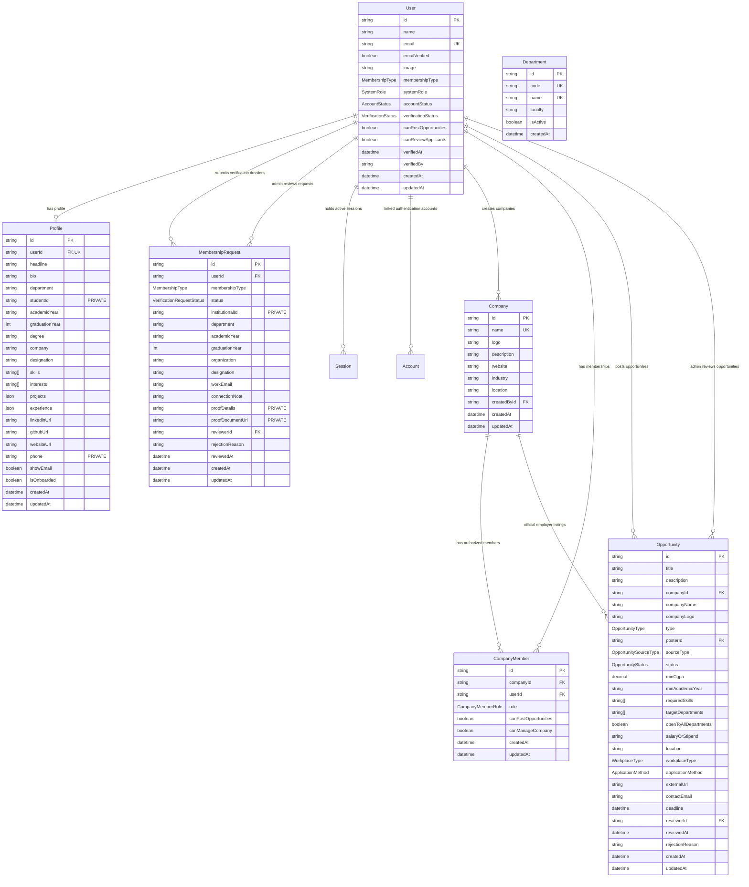

# UniCareer Community — Database Schema Specification

> **Architectural Status**: Stage 6 (Companies, Opportunities, and Approval System) Complete  
> **Database Engine**: PostgreSQL 16 on Neon via Prisma ORM 7.10.1 & `@prisma/adapter-pg`  
> **Models In Production**: `User`, `Profile`, `MembershipRequest`, `Company`, `CompanyMember`, `Department`, `Opportunity`, `Session`, `Account`, `Verification`

---

## 1. Active Stage 6 Entity Relationships

---

## 2. Table Specifications

### `users`
| Column | Type | Constraints | Description |
| :--- | :--- | :--- | :--- |
| `id` | `VARCHAR(30)` | `PRIMARY KEY` (cuid) | Unique member identifier |
| `name` | `VARCHAR(100)` | `NOT NULL` | Full member display name |
| `email` | `VARCHAR(255)` | `NOT NULL`, `UNIQUE` | Unique institutional email |
| `emailVerified`| `BOOLEAN` | `DEFAULT false` | Verified via cryptographic email link |
| `image` | `TEXT` | `NULLABLE` | Avatar image URL |
| `membershipType` | `MembershipType` | `DEFAULT STUDENT` | `STUDENT`, `ALUMNI`, `FACULTY`, `STAFF`, `EMPLOYER`, `EXTERNAL_CONNECTION` |
| `systemRole` | `SystemRole` | `DEFAULT MEMBER` | `MEMBER`, `MODERATOR`, `ADMIN` (Decoupled from membership) |
| `accountStatus`| `AccountStatus`| `DEFAULT ACTIVE` | `ACTIVE`, `PENDING_VERIFICATION`, `SUSPENDED`, `DEACTIVATED` |
| `verificationStatus` | `VerificationStatus` | `DEFAULT PENDING` | `PENDING`, `VERIFIED`, `REJECTED`, `SUSPENDED` |
| `canPostOpportunities` | `BOOLEAN` | `DEFAULT false` | Posting clearance flag |
| `canReviewApplicants` | `BOOLEAN` | `DEFAULT false` | Candidate review clearance flag |
| `verifiedAt` | `TIMESTAMPTZ` | `NULLABLE` | Timestamp of admin verification |
| `verifiedBy` | `VARCHAR(30)` | `NULLABLE` | Admin user ID who validated credentials |
| `createdAt` | `TIMESTAMPTZ` | `DEFAULT now()` | Account creation timestamp |
| `updatedAt` | `TIMESTAMPTZ` | `AUTO UPDATE` | Last modified timestamp |

### `companies`
| Column | Type | Constraints | Description |
| :--- | :--- | :--- | :--- |
| `id` | `VARCHAR(30)` | `PRIMARY KEY` (cuid) | Unique company identifier |
| `name` | `VARCHAR(100)` | `NOT NULL`, `UNIQUE` | Registered legal or trade name |
| `logo` | `TEXT` | `NULLABLE` | Corporate emblem or logo URL |
| `description`| `TEXT` | `NULLABLE` | Corporate profile and mission |
| `website` | `TEXT` | `NULLABLE` | Official company website URL |
| `industry` | `VARCHAR(100)` | `NULLABLE` | Industry domain (e.g., Software, Fintech) |
| `location` | `VARCHAR(100)` | `NULLABLE` | Headquarters city or region |
| `createdById`| `VARCHAR(30)` | `NOT NULL`, `FK` | References `users(id)` ON DELETE RESTRICT |
| `createdAt` | `TIMESTAMPTZ` | `DEFAULT now()` | Entity creation timestamp |
| `updatedAt` | `TIMESTAMPTZ` | `AUTO UPDATE` | Entity last modified timestamp |

### `company_members`
| Column | Type | Constraints | Description |
| :--- | :--- | :--- | :--- |
| `id` | `VARCHAR(30)` | `PRIMARY KEY` (cuid) | Unique association identifier |
| `companyId` | `VARCHAR(30)` | `NOT NULL`, `FK` | References `companies(id)` ON DELETE CASCADE |
| `userId` | `VARCHAR(30)` | `NOT NULL`, `FK` | References `users(id)` ON DELETE CASCADE |
| `role` | `CompanyMemberRole` | `DEFAULT MEMBER` | `OWNER`, `ADMIN`, `MEMBER` |
| `canPostOpportunities` | `BOOLEAN` | `DEFAULT true` | Authorized to post job/internship listings |
| `canManageCompany` | `BOOLEAN` | `DEFAULT false` | Authorized to edit company info & manage members |
| `createdAt` | `TIMESTAMPTZ` | `DEFAULT now()` | Membership creation timestamp |
| `updatedAt` | `TIMESTAMPTZ` | `AUTO UPDATE` | Membership update timestamp |
| *Constraints* | `UNIQUE(companyId, userId)` | Composite unique | Prevents duplicate memberships |

### `departments`
| Column | Type | Constraints | Description |
| :--- | :--- | :--- | :--- |
| `id` | `VARCHAR(30)` | `PRIMARY KEY` (cuid) | Unique department identifier |
| `code` | `VARCHAR(20)` | `NOT NULL`, `UNIQUE` | Canonical abbreviation (e.g., `CSE`, `BBA`) |
| `name` | `VARCHAR(120)` | `NOT NULL`, `UNIQUE` | Full academic department name |
| `faculty` | `VARCHAR(120)` | `NOT NULL` | Governing faculty (e.g. Faculty of Science) |
| `isActive` | `BOOLEAN` | `DEFAULT true` | Active enrollment flag |
| `createdAt` | `TIMESTAMPTZ` | `DEFAULT now()` | Record creation timestamp |

### `opportunities`
| Column | Type | Constraints | Description |
| :--- | :--- | :--- | :--- |
| `id` | `VARCHAR(30)` | `PRIMARY KEY` (cuid) | Unique opportunity identifier |
| `title` | `VARCHAR(120)` | `NOT NULL` | Job or internship headline |
| `description`| `TEXT` | `NOT NULL` | Comprehensive responsibilities & criteria |
| `companyId` | `VARCHAR(30)` | `NULLABLE`, `FK` | References `companies(id)` ON DELETE SET NULL |
| `companyName`| `VARCHAR(100)`| `NOT NULL` | Explicit company name (canonical or fallback) |
| `companyLogo`| `TEXT` | `NULLABLE` | Company logo URL |
| `type` | `OpportunityType`| `DEFAULT FULL_TIME` | `INTERNSHIP`, `FULL_TIME`, `PART_TIME`, `CONTRACT`, `OTHER` |
| `posterId` | `VARCHAR(30)` | `NOT NULL`, `FK` | Submitting member referencing `users(id)` |
| `sourceType` | `OpportunitySourceType` | `DEFAULT COMMUNITY_SHARED` | `OFFICIAL_EMPLOYER` vs `COMMUNITY_SHARED` |
| `status` | `OpportunityStatus`| `DEFAULT DRAFT` | `DRAFT`, `PENDING`, `APPROVED`, `REJECTED`, `EXPIRED`, `CLOSED` |
| `minCgpa` | `DECIMAL(3,2)` | `NULLABLE` | Minimum CGPA threshold (0.00 – 4.00) |
| `minAcademicYear` | `VARCHAR(50)` | `NULLABLE` | Minimum academic standing (e.g. 3rd Year) |
| `requiredSkills` | `TEXT[]` | `DEFAULT '{}'` | Skill tags required for role |
| `targetDepartments` | `TEXT[]`| `DEFAULT '{}'` | Target academic disciplines |
| `openToAllDepartments` | `BOOLEAN` | `DEFAULT true` | When true, open across all disciplines |
| `salaryOrStipend` | `VARCHAR(100)` | `NULLABLE` | Compensation or stipend details |
| `location` | `VARCHAR(100)` | `NOT NULL` | Physical work location or city |
| `workplaceType` | `WorkplaceType` | `DEFAULT ON_SITE` | `ON_SITE`, `REMOTE`, `HYBRID` |
| `applicationMethod` | `ApplicationMethod` | `DEFAULT INTERNAL` | `INTERNAL`, `EXTERNAL` |
| `externalUrl` | `TEXT` | `NULLABLE` | External application URL (required for external) |
| `contactEmail` | `VARCHAR(255)` | `NULLABLE` | Point-of-contact for inquiries |
| `deadline` | `TIMESTAMPTZ` | `NOT NULL` | Future application cutoff date |
| `reviewerId` | `VARCHAR(30)` | `NULLABLE`, `FK` | Reviewing Platform Admin `users(id)` |
| `reviewedAt` | `TIMESTAMPTZ` | `NULLABLE` | Admin moderation timestamp |
| `rejectionReason` | `TEXT` | `NULLABLE` | Mandatory feedback when rejected |
| `createdAt` | `TIMESTAMPTZ` | `DEFAULT now()` | Submission timestamp |
| `updatedAt` | `TIMESTAMPTZ` | `AUTO UPDATE` | Last modification timestamp |

---

## 3. Database Indexes

| Table | Index Name | Columns | Purpose |
| :--- | :--- | :--- | :--- |
| `companies` | `companies_name_key` | `name` (UNIQUE) | Fast canonical company lookup |
| `companies` | `companies_createdById_idx` | `createdById` | Listing creator's companies |
| `company_members` | `company_members_companyId_userId_key` | `companyId, userId` (UNIQUE) | Prevents duplicate memberships |
| `company_members` | `company_members_userId_idx` | `userId` | Fast resolution of user's managed companies |
| `opportunities` | `opportunities_status_idx` | `status` | Querying approved or pending listings |
| `opportunities` | `opportunities_posterId_idx` | `posterId` | Author's dashboard listings |
| `opportunities` | `opportunities_companyId_idx` | `companyId` | Official company listing lookups |
| `opportunities` | `opportunities_type_idx` | `type` | Filtering internships vs full-time jobs |
| `opportunities` | `opportunities_deadline_idx` | `deadline` | Expiration daemon queries |
