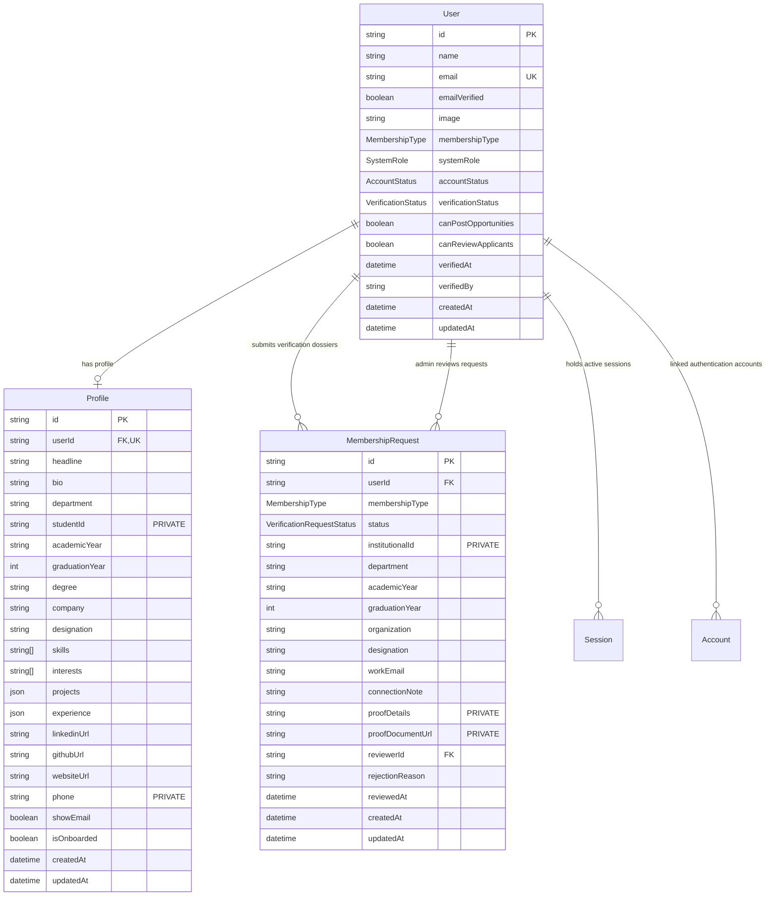

# UniCareer Community — Database Schema Specification

> **Architectural Status**: Stage 5 (Membership Verification & User Profiles Engine) Complete  
> **Database Engine**: PostgreSQL 16 on Neon via Prisma ORM 7.10.1 & `@prisma/adapter-pg`  
> **Models In Production**: `User`, `Profile`, `MembershipRequest`, `Session`, `Account`, `Verification`

---

## 1. Active Stage 5 Entity Relationships

---

## 2. Table Specifications

### `users`
| Column | Type | Constraints | Description |
| :--- | :--- | :--- | :--- |
| `id` | `VARCHAR(30)` | `PRIMARY KEY` (cuid) | Unique member identifier |
| `name` | `VARCHAR(100)` | `NOT NULL` | Full member display name |
| `email` | `VARCHAR(255)` | `NOT NULL`, `UNIQUE` | Unique institutional email |
| `emailVerified`| `BOOLEAN` | `DEFAULT false` | Verified via cryptographic email link |
| `image` | `TEXT` | `NULLABLE` | Avatar image URL |
| `membershipType` | `MembershipType` | `DEFAULT STUDENT` | `STUDENT`, `ALUMNI`, `FACULTY`, `STAFF`, `EMPLOYER`, `EXTERNAL_CONNECTION` |
| `systemRole` | `SystemRole` | `DEFAULT MEMBER` | `MEMBER`, `MODERATOR`, `ADMIN` (Decoupled from membership) |
| `accountStatus`| `AccountStatus`| `DEFAULT ACTIVE` | `ACTIVE`, `PENDING_VERIFICATION`, `SUSPENDED`, `DEACTIVATED` |
| `verificationStatus` | `VerificationStatus` | `DEFAULT PENDING` | `PENDING`, `VERIFIED`, `REJECTED`, `SUSPENDED` |
| `canPostOpportunities` | `BOOLEAN` | `DEFAULT false` | Posting clearance flag |
| `canReviewApplicants` | `BOOLEAN` | `DEFAULT false` | Candidate review clearance flag |
| `verifiedAt` | `TIMESTAMPTZ` | `NULLABLE` | Timestamp of admin verification |
| `verifiedBy` | `VARCHAR(30)` | `NULLABLE` | Admin user ID who validated credentials |
| `createdAt` | `TIMESTAMPTZ` | `DEFAULT now()` | Account creation timestamp |
| `updatedAt` | `TIMESTAMPTZ` | `AUTO UPDATE` | Last modified timestamp |

### `profiles`
| Column | Type | Constraints | Description |
| :--- | :--- | :--- | :--- |
| `id` | `VARCHAR(30)` | `PRIMARY KEY` (cuid) | Unique profile identifier |
| `userId` | `VARCHAR(30)` | `NOT NULL`, `UNIQUE`, `FK` | References `users(id)` ON DELETE CASCADE |
| `headline` | `VARCHAR(160)` | `NULLABLE` | Professional headline |
| `bio` | `TEXT` | `NULLABLE` | Member biography |
| `department` | `VARCHAR(100)` | `NULLABLE` | Academic department or faculty |
| `studentId` | `VARCHAR(50)` | `NULLABLE` | **PRIVATE**: Masked from regular members |
| `academicYear` | `VARCHAR(50)` | `NULLABLE` | Academic standing (e.g. 3rd Year) |
| `graduationYear` | `INTEGER` | `NULLABLE` | Graduation or intake year |
| `degree` | `VARCHAR(100)` | `NULLABLE` | Program degree (e.g. B.Sc. in CSE) |
| `company` | `VARCHAR(100)` | `NULLABLE` | Current corporate organization |
| `designation` | `VARCHAR(100)` | `NULLABLE` | Job role or academic rank |
| `skills` | `TEXT[]` | `DEFAULT '{}'` | Array of technical and professional skills |
| `interests` | `TEXT[]` | `DEFAULT '{}'` | Array of career interest domains |
| `projects` | `JSONB` | `NULLABLE` | Array of projects with title, techStack, links |
| `experience` | `JSONB` | `NULLABLE` | Array of work experiences |
| `linkedinUrl` | `TEXT` | `NULLABLE` | LinkedIn URL |
| `githubUrl` | `TEXT` | `NULLABLE` | GitHub URL |
| `websiteUrl` | `TEXT` | `NULLABLE` | Personal portfolio URL |
| `phone` | `VARCHAR(30)` | `NULLABLE` | **PRIVATE**: Masked from regular members |
| `showEmail` | `BOOLEAN` | `DEFAULT false` | Privacy flag to display email publicly |
| `isOnboarded` | `BOOLEAN` | `DEFAULT false` | Completed onboarding flow flag |

### `membership_requests`
| Column | Type | Constraints | Description |
| :--- | :--- | :--- | :--- |
| `id` | `VARCHAR(30)` | `PRIMARY KEY` (cuid) | Unique request identifier |
| `userId` | `VARCHAR(30)` | `NOT NULL`, `FK` | Submitting member ID |
| `membershipType` | `MembershipType` | `NOT NULL` | Requested institutional identity |
| `status` | `VerificationRequestStatus` | `DEFAULT PENDING` | `PENDING`, `APPROVED`, `REJECTED` |
| `institutionalId` | `VARCHAR(100)` | `NULLABLE` | **PRIVATE**: Student or Employee ID |
| `department` | `VARCHAR(100)` | `NULLABLE` | Affiliation department |
| `academicYear` | `VARCHAR(50)` | `NULLABLE` | Academic standing |
| `graduationYear` | `INTEGER` | `NULLABLE` | Graduation year |
| `organization` | `VARCHAR(150)` | `NULLABLE` | Hiring firm or partner entity |
| `designation` | `VARCHAR(100)` | `NULLABLE` | Work title |
| `workEmail` | `VARCHAR(255)` | `NULLABLE` | Official corporate or faculty email |
| `connectionNote` | `TEXT` | `NULLABLE` | Partnership connection explanation |
| `proofDetails` | `TEXT` | `NULLABLE` | **PRIVATE**: Academic or employer proof details |
| `proofDocumentUrl` | `TEXT` | `NULLABLE` | **PRIVATE**: Uploaded credential document |
| `reviewerId` | `VARCHAR(30)` | `NULLABLE`, `FK` | Platform Admin who evaluated request |
| `rejectionReason` | `TEXT` | `NULLABLE` | Mandatory explanation upon rejection |
| `reviewedAt` | `TIMESTAMPTZ` | `NULLABLE` | Review timestamp |
| `createdAt` | `TIMESTAMPTZ` | `DEFAULT now()` | Submission timestamp |
