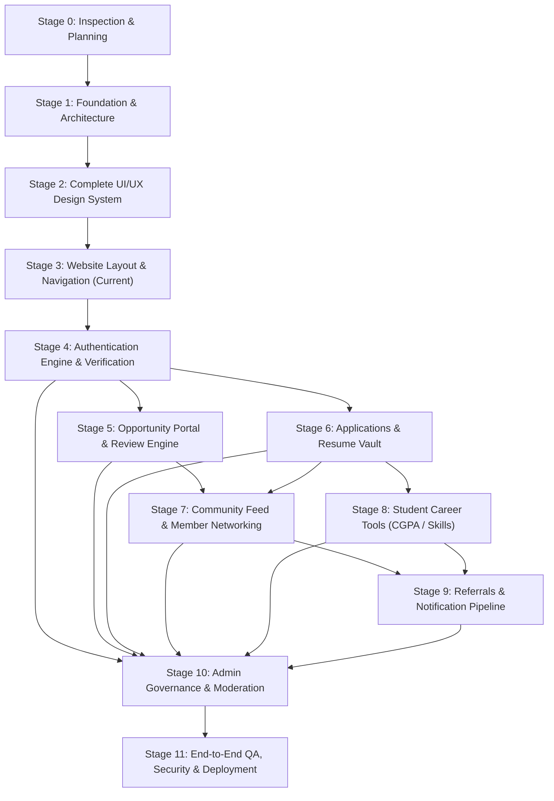

# UniCareer Community — Development Roadmap & Stage Dependency Matrix

## 1. Stage Dependency Graph

---

## 2. Stage Execution Log & Milestones

### Stage 0: Project Inspection & Planning
- **Status**: **COMPLETE** (2026-10-30)
- **Prerequisites**: None.
- **Core Deliverables Delivered**:
  - Environmental inspection and package stack verification.
  - 13 development skills installed and configured.
  - Git repository initialized.
  - 27-entity relational database ERD and comprehensive architectural contracts.
  - Complete living documentation system created in `docs/`.

### Stage 1: Project Foundation & Architecture
- **Status**: **COMPLETE** (2026-10-30)
- **Prerequisites**: Stage 0.
- **Core Deliverables Delivered**:
  - Next.js 16.4.3 (App Router) + React 19.3.0 + TypeScript 5.
  - Tailwind CSS v4 with `@tailwindcss/turbopack` and shadcn/ui components integration.
  - OKLCH University Navy / Royal Blue color tokens with Light, Dark, and System theme switching.
  - Shell layout with `AppNavbar`, `AppFooter`, `ThemeToggle`, `ErrorBoundary`, `GlobalError`, and `NotFound` pages.
  - Database connectivity established with PostgreSQL 16 via Prisma 7 & `@prisma/adapter-pg`.
  - Development and test scripts configured (`dev`, `build`, `start`, `lint`, `type-check`, `test`, `db:seed`, `db:generate`).
  - Unit tests verified using Vitest (5/5 passing).

### Stage 2: Complete UI/UX Design System
- **Status**: **COMPLETE** (2026-10-30)
- **Prerequisites**: Stage 1.
- **Core Deliverables Delivered**:
  - Full design tokens, OKLCH palette, Inter typography scale, and WCAG 2.1 AA contrast in `app/globals.css`.
  - Light, Dark, and System theme persistence with zero-cascading-render `ThemeToggle`.
  - 17 reusable UI primitives in `components/ui/` (buttons, forms, badges, dialogs, tables, tabs, toasts, skeletons).
  - 3 feedback micro-UIs in `components/feedback/` (`EmptyState`, `ErrorBanner`, `ConfirmDialog`).
  - 8 Opportunity domain components in `components/opportunities/` (`JobCard`, `CompanyCard`, `EmployerBadge`, `VerifiedBadge`, `MatchScoreIndicator`, `DeadlineIndicator`, `ApplicationStatusBadge`, `ApplicantSummaryCard`).
  - 7 Community domain components in `components/community/` (`CreatePostBox`, `FeedPostCard`, `ReactionButtons`, `MemberProfileCard`, `ConnectionButton`, `ReferralCard`, `CommentThread`).
  - Interactive Design System demonstration page at `/design-system`.
  - Automated component unit tests (7/7 passing).

### Stage 3: Website Layout & Navigation
- **Status**: **COMPLETE** (2026-10-30)
- **Prerequisites**: Stage 2.
- **Core Deliverables Delivered**:
  - **Shared Authenticated Shell**: Responsive desktop sidebar (`AppSidebar`), sticky header (`AppHeader`) with global search and notification drawer, and mobile bottom bar + off-canvas drawer (`MobileNav`).
  - **Public Gated Entry Layout**: `app/(public)/layout.tsx` wrapping welcome landing (`/`), mission background (`/about`), terms of service (`/terms`), and student data privacy statement (`/privacy`). Zero public leakage of member directories or job details.
  - **Distraction-Free Auth Shell**: `app/(auth)/layout.tsx` wrapping member login (`/login`), verified registration (`/register`), and password recovery (`/forgot-password`).
  - **6 Reusable Page Templates**: `DashboardTemplate`, `ListingTemplate`, `DetailsTemplate`, `FormTemplate`, `ProfileTemplate`, `AdminTemplate`.
  - **Authenticated Domain Views**: Full page implementations for `/dashboard`, `/feed`, `/opportunities`, `/opportunities/[id]`, `/opportunities/post`, `/community`, `/referrals`, `/applications`, `/career-tools`, `/contributions`, `/profile/me`, `/settings`, `/notifications`, `/admin`.
  - **Added UI Primitives**: `Label` and `Progress` components.
  - **Unit Testing**: Vitest test suite expanded to 11 passing tests.
  - **Production Build**: 24/24 static and partial prerendered routes compiled with Turbopack. Zero TypeScript or ESLint errors.

### Stage 4: Authentication Engine, Accounts & Verification
- **Status**: **COMPLETE** (2026-11-05)
- **Prerequisites**: Stage 3.
- **Core Deliverables Delivered**:
  - **Selected Authentication Core**: Better Auth 1.7.17 configured with Prisma 7 adapter (`@prisma/adapter-pg`) on PostgreSQL 16.
  - **Account Data Models (`prisma/schema.prisma`)**: `users`, `sessions`, `accounts`, `verifications` tables synced to PostgreSQL.
  - **Role & Membership Separation**: `membershipType` (`STUDENT`, `ALUMNI`, `FACULTY`, `STAFF`, `EMPLOYER`, `EXTERNAL_CONNECTION`) kept completely separate from `systemRole` (`MEMBER`, `MODERATOR`, `ADMIN`).
  - **Password Security**: Scrypt salted/hashed password storage in `accounts` table. Plaintext passwords never stored.
  - **Email Verification Pipeline**: Cryptographic verification token generation, token dispatch via development logger store (`lib/email.ts`), automated redemption at `/verify-email`.
  - **Password Reset Pipeline**: 30-minute cryptographic recovery token issuance and single-use password update at `/reset-password`.
  - **Two-Layer Route Protection**:
    - Network Edge Proxy (`proxy.ts`): 307 temporary redirects for unauthenticated requests on protected routes with preserved `callbackUrl`.
    - Server Component Layout Guard (`app/(dashboard)/layout.tsx`): Authenticates session against PostgreSQL, enforces account active status (`SUSPENDED`/`DEACTIVATED` rejection).
  - **Polished Authentication UX**: Fully functional client forms for Login, Multi-Role Registration, Forgot Password, Reset Password, and Email Verification with loading spinners and accessible error states.
  - **Interactive User Menu**: Integrated live session display with working `signOut()` action.
  - **Automated Testing**: 27/27 Vitest unit and integration tests passing. Clean Next.js 16 production build.

### Stage 5: Membership Verification & User Profiles Engine
- **Status**: **COMPLETE** (2026-11-05)
- **Prerequisites**: Stage 4.
- **Core Deliverables Delivered**:
  - **Decoupled Identity Models (`prisma/schema.prisma`)**: Integrated `Profile` and `MembershipRequest` models into PostgreSQL. Retained strict separation between institutional `MembershipType` and platform `SystemRole`.
  - **Role-Tailored Onboarding Flow (`/onboarding`)**: Dynamic multi-step onboarding tailored to `STUDENT`, `ALUMNI`, `FACULTY`, `STAFF`, `EMPLOYER`, and `EXTERNAL_CONNECTION` with instant validation and database submission.
  - **Verification Review & Admin Center (`/admin`)**: Fully functional administrative verification management interface displaying applicant claims and evidence with live Approve and Reject with mandatory reason workflows.
  - **Resubmission & Historical Audit**: Rejection reasons displayed clearly to members with one-click resubmission modal and multi-attempt historical tracking in `membership_requests`.
  - **Profile System & In-Place Editing (`/profile/me`)**: Live database-connected member profile with status badges, institutional dossier, skills, experience, projects, links, and responsive `EditProfileModal`.
  - **Strict Profile Privacy Redaction (`/profile/[id]`)**: `getPublicProfile` server service redacts sensitive Student IDs, personal phone numbers, and private emails for general community members.
  - **Server-Enforced Opportunity Posting Clearance (`lib/permissions.ts`)**: `canPostOpportunity` and `assertCanPostOpportunity` guarantee that unverified members cannot publish opportunities by altering frontend state.
  - **Automated Testing**: 42/42 Vitest unit and integration tests passing. Clean Next.js 16 production build.

### Stage 6: Companies, Opportunities, and Approval System
- **Status**: **COMPLETE** (2026-11-05)
- **Prerequisites**: Stage 5.
- **Core Deliverables Delivered**:
  - **Company Database Model & RBAC (`prisma/schema.prisma`)**: Integrated `Company` and `CompanyMember` models with role-based governance (`OWNER`, `ADMIN`, `MEMBER`) and granular capability flags (`canManageCompany`, `canPostOpportunities`). Creator is automatically assigned as company `OWNER`.
  - **Opportunity Model & Lifecycle**: Comprehensive `Opportunity` schema supporting 5 opportunity types (`INTERNSHIP`, `FULL_TIME`, `PART_TIME`, `CONTRACT`, `OTHER`), 2 provenance classifications (`OFFICIAL_EMPLOYER`, `COMMUNITY_SHARED`), 6 statuses (`DRAFT`, `PENDING`, `APPROVED`, `REJECTED`, `EXPIRED`, `CLOSED`), workplace types, application methods, minimum CGPA scale, academic year, and compensation.
  - **University Department Targeting**: Seeded 16 canonical Jagannath University departments into `departments` table. Supported department-specific targeting and `openToAllDepartments` filtering.
  - **Institutional Approval & Moderation System**: Server-side review queue (`getPendingOpportunities`, `reviewOpportunity`). Platform administrators evaluate opportunities with mandatory rejection feedback and permanent reviewer attribution.
  - **Anti-IDOR & Permission Assertion Services (`lib/services/`)**: `assertCanManageCompany`, `assertCanPostForCompany`, `assertCanModifyOpportunity`, and `createOpportunity` enforce server-side boundaries preventing unauthorized publishing, company editing, or unapproved posting discovery.
  - **REST API Suite (`app/api/`)**: Implemented `/api/companies`, `/api/companies/[id]`, `/api/companies/[id]/members`, `/api/departments`, `/api/opportunities`, `/api/opportunities/[id]`, `/api/opportunities/[id]/submit`, `/api/opportunities/[id]/close`, and `/api/admin/opportunities`.
  - **Interactive Admin Moderation UI (`components/admin/opportunity-review-table.tsx`)**: Live administrative review table integrated into `/admin` with modal dialogues for Approve and Reject with mandatory justification.
  - **Automated Testing**: 18 new unit and integration tests (60/60 passing across all 8 test files).
  - **Production Build**: 37 App Router routes compiled cleanly with Next.js Turbopack.

### Stage 7: Job Browsing, Searching, and Posting Interfaces
- **Status**: **COMPLETE** (2026-11-05)
- **Prerequisites**: Stage 6.
- **Core Deliverables Delivered**:
  - **Opportunity Browsing Page (`/opportunities`)**: Approved opportunity discovery grid displaying company logos, job title, type, location, workplace mode, compensation, urgency deadline indicator, required skills, department tags, and official vs community-shared provenance badges.
  - **Multi-Filter & Real-Time Search**: Live keyword search with debouncing, opportunity type, workplace mode, source type, department targeting, and minimum CGPA filters working directly against backend database queries with pagination.
  - **Opportunity Details View (`/opportunities/[id]`)**: Full job specifications, company identity, requirements, academic criteria, application routing (external redirect vs internal notice), deadline countdown, poster attribution, bookmark toggle, and related openings.
  - **Opportunity Submission Interface (`/opportunities/post`)**: React Hook Form + Zod form supporting managed company selection or custom company names, skills tag input, target department multi-selection, and server-side posting clearance checks.
  - **Posting Workflow with Live Preview**: Seamless toggle between form mode and live card preview mode. Support for saving as `DRAFT` or direct submission for institutional review (`PENDING`).
  - **Author Console (`/opportunities/my`)**: Dedicated authoring console categorized by status (`ALL`, `APPROVED`, `PENDING`, `DRAFT`, `REJECTED`, `CLOSED`, `EXPIRED`) with status counts, draft submission, opportunity closure, deletion, and rejected resubmission workflows.
  - **Opportunity Bookmarks Engine**: `OpportunityBookmark` database model with composite unique constraint, toggle API (`/api/opportunities/[id]/bookmark`), saved listings collection (`/opportunities/saved`), and real-time bookmark status decoration.
  - **User Experience & State Completeness**: Loading skeletons, empty states, confirmation dialogs, toast notifications, responsive mobile layouts, and complete light/dark theme support.
  - **Automated Testing**: 14 new unit and integration tests (74/74 passing across all 9 test files). Clean Next.js 16 production build (41 routes).

---

## 3. Next Stage Preview

### Stage 8: Applications and Applicant Management
- **Status**: **COMPLETE** (2026-11-05)
- **Prerequisites**: Stage 7.
- **Core Deliverables Delivered**:
  - **Application Database & Unique Constraints (`prisma/schema.prisma`)**: Integrated `Application`, `Resume`, and `ApplicationStatusHistory` models with database-level composite unique constraint `@@unique([opportunityId, applicantId])` preventing duplicate applications.
  - **Secure Private Resume Vault (`lib/services/resume.ts`)**: Private disk storage in `storage/resumes/` outside public web root with magic-bytes inspection (`%PDF-` for PDF, `PK\x03\x04` for DOCX) verifying actual file headers rather than browser-supplied MIME types. Anti-IDOR download authorization (`/api/resumes/[id]/download`).
  - **Dual Application Methods**: Supported `INTERNAL_APPLICATION` (direct via UniCareer with resume selection/upload and cover letter) and `EXTERNAL_APPLICATION` (redirects to third-party employer portal with disclaimer and manual activity recording).
  - **Eligibility & Pre-Flight Validation**: Real-time pre-flight verification checking department eligibility, deadline expiration, opportunity status, and advisory CGPA warnings.
  - **Candidate Self-Service Dashboard (`/applications`)**: Live applicant dashboard (`MyApplicationsView`) displaying applied opportunities, real-time status badges, submitted resume downloads, application detail modal, and application withdrawal.
  - **Employer Applicant Management Console (`/opportunities/[id]/applicants`)**: Live recruiter dashboard (`EmployerApplicantManager`) for authorized company managers with candidate dossier review, candidate resume access, status transition management (`SUBMITTED`, `UNDER_REVIEW`, `SHORTLISTED`, `INTERVIEW`, `SELECTED`, `REJECTED`, `WITHDRAWN`), status audit trail, and private recruiter notes.
  - **Community Poster Strict Isolation**: Server-enforced verification (`assertCanManageApplicantsForOpportunity`) ensuring members who merely shared job leads (`COMMUNITY_SHARED`) cannot access candidate dossiers or download resumes (403 Forbidden).
  - **Automated Testing**: 17 new unit tests in `tests/unit/applications.test.ts` (91/91 passing across all 10 test files).
  - **Production Build**: 44 App Router routes compiled cleanly with Next.js Turbopack.

---

### Stage 9: Community Feed, Discussions & Moderation
- **Status**: **COMPLETE** (2026-11-05)
- **Prerequisites**: Stage 8.
- **Core Deliverables Delivered**:
  - **Community Database Models (`prisma/schema.prisma`)**: Integrated `Post`, `Comment`, `PostReaction`, `PostBookmark`, and `ContentReport` models into PostgreSQL with granular enums (`PostType`, `ModerationStatus`, `PostVisibility`, `ReactionType`, `ReportTargetType`, `ReportReason`, `ReportStatus`).
  - **Composite Unique Constraints**: Database-level unique constraint `@@unique([postId, userId, type])` preventing duplicate reactions of the same type, and `@@unique([postId, userId])` preventing duplicate post bookmarks.
  - **Dedicated Community Feed (`/feed`) & Live Dashboard (`/dashboard`)**: Full-featured feeds built on `CommunityFeedView` supporting channel filtering (`GENERAL_DISCUSSION`, `CAREER_ADVICE`, `QUESTION`, `REFERRAL_REQUEST`, `JOB_ANNOUNCEMENT`, `INTERNSHIP_ANNOUNCEMENT`, `ACHIEVEMENT`, `BOOKMARKED`), live debounced search, active university statistics, loading skeletons, and pagination.
  - **Interactive Post Creation (`CreatePostBox`)**: Rich post publisher supporting post type selection, optional headline, topic tag chips, opportunity linkage, character counters (min 10, max 5,000 chars), and immediate optimistic feed updates.
  - **Threaded Comments & Replies (`CommentThread`)**: Single-level hierarchical reply structure (`parentId`), in-place comment editing for authors, comment deletion with automatic post count synchronization, and comment reporting.
  - **Atomic Reactions Engine**: Like, Insightful, Support, and Celebrate reaction buttons with real-time counters, toggle-off capability, and clean type switching.
  - **Post Interactions & Bookmarks**: In-place post editing (author or admin), post deletion with cascade, saved posts collection (`/api/posts/bookmarks`), and internal shareable link generation.
  - **Community Content Moderation Foundation**: Report dialog for posts and comments with categorized reasons (`SPAM`, `HARASSMENT`, `INAPPROPRIATE`, `MISINFORMATION`, `OTHER`), duplicate report protection, and auto-flagging threshold (flagged when >= 3 pending reports are lodged).
  - **Automated Testing**: 22 new unit and integration tests in `tests/unit/community.test.ts` (113/113 passing across all 11 test files).
  - **Production Build**: 46 App Router routes compiled cleanly with Next.js Turbopack.

---

### Stage 10: Member Directory, Connections & Referrals
- **Status**: **COMPLETE** (2026-11-05)
- **Prerequisites**: Stage 9.
- **Core Deliverables Delivered**:
  - **Connections & Referrals Database Models (`prisma/schema.prisma`)**: Integrated `Connection` and `ReferralRequest` models into PostgreSQL with enums `ConnectionStatus` (`PENDING`, `ACCEPTED`, `REJECTED`) and `ReferralStatus` (`PENDING`, `ACCEPTED`, `DECLINED`, `COMPLETED`, `CANCELLED`).
  - **Composite Unique Constraints**: Database-level unique constraint `@@unique([senderId, receiverId])` preventing duplicate connection requests.
  - **Searchable Member Directory (`/community`)**: Real database-driven directory (`MemberDirectoryView`) with live debounced search, filtering by department, membership type, company, and skill, with strict redaction of private fields (`studentId`, `phone`, private email).
  - **Direct Connection Engine**: Robust connection request lifecycle (`sendConnectionRequest`, `respondToConnectionRequest`, `cancelConnectionRequest`, `removeConnection`) with self-connect prevention and bidirectional state tracking (`ConnectionButton`).
  - **Dedicated Referral Request System (`/referrals`)**: Full-featured referrals hub (`ReferralsHubView`) with incoming/outgoing tabs, request referral modal (`RequestReferralModal`), role & company selection, response workflow (`ACCEPTED`, `DECLINED`, `COMPLETED`), and non-guarantee disclaimers.
  - **Strict Server-Side Referral Privacy**: `assertCanAccessReferral` ensuring only requester, recipient, or platform admin can inspect private request dossiers (403 Forbidden for unauthorized members).
  - **Enriched Member Profile Detail (`/profile/[id]`)**: Full public dossier with connection status actions, "Request Referral" trigger, shared university connection counts, and recent community activity posts.
  - **Automated Testing**: 12 new unit and integration tests in `tests/unit/connections-and-referrals.test.ts` (125/125 passing across all 12 test files).
  - **Production Build**: 50 App Router routes compiled cleanly with Next.js Turbopack.

---

### Stage 11: Smart Matching and Student Career Tools
- **Status**: **COMPLETE** (2026-11-05)
- **Prerequisites**: Stage 10.
- **Core Deliverables Delivered**:
  - **Skills & Academic Models (`prisma/schema.prisma`)**: Integrated `Skill`, `MemberSkill`, `OpportunitySkill`, and `AcademicRecord` into PostgreSQL with enums `SkillCategory` (12 categories) and `SkillLevel` (`BEGINNER`, `INTERMEDIATE`, `ADVANCED`, `EXPERT`). Added cached `currentCgpa` on `Profile`.
  - **Shared Controlled Skill Dictionary (`lib/services/skill.ts`)**: Auto-seeded standard catalog of 30+ engineering, tech, and business skills with category mappings, duplicate prevention, and automated synchronization of `Profile.skills` string array on association and removal.
  - **Explainable Skill Match Scoring (`lib/services/matching.ts`)**: Mathematical overlap score $\frac{\text{Matched Required Skills}}{\text{Total Required Skills}} \times 100$ with strict color coding (Green $\ge 80\%$, Yellow $50\% - 79\%$, Red $< 50\%$), clean handling of 0 required skills (100% with note), and mandatory non-guarantee disclaimer.
  - **Institutional Eligibility Checker**: Comprehensive eligibility verification checking minimum CGPA cutoff, target academic departments, academic year standing, application deadline expiration, and opportunity approval status. Evaluates `ELIGIBLE`, `NOT_ELIGIBLE`, or `NEEDS_REVIEW` (for incomplete profile data).
  - **Skill Gap & Curriculum Market Analyzer**: Aggregation of competencies across all active approved campus opportunities to compute real market demand frequency, contrast student competencies against missing requirements, generate top 5 prioritized recommendations, and curate verified educational resources.
  - **Confidential Academic Transcript & CGPA Vault (`lib/services/academic.ts`)**: Term GPA and credits tracker using standard credit-weighted formula $\frac{\sum (\text{GPA}_i \times \text{Credits}_i)}{\sum \text{Credits}_i}$, unique semester constraint per student (`@@unique([userId, semester])`), and automatic sync of cached `Profile.currentCgpa`.
  - **Strict Academic Privacy & Non-Student Role Isolation**: Academic transcripts and semester GPAs are confidential, visible ONLY to the student and platform administrators (`ACCESS_DENIED` / 403 Forbidden). Non-student profiles navigating to `/career-tools` are greeted with a graceful explanatory banner and redirected to opportunities and community feeds.
  - **Personalized Student Career Dashboard (`/career-tools`)**: Interactive multi-tab hub (`CareerDashboardView`) featuring Recommendations (match score badges, reasons, checklist eligibility, filter by department), Skill Gap Analyzer (market demand cards, prioritized recommendations, learning tracks), and Academic Performance (cumulative CGPA gauge, semester transcript log, `AddSemesterModal`).
  - **Automated Testing**: 20 new unit and integration tests in `tests/unit/smart-matching-and-career-tools.test.ts` (145/145 passing across all 13 test files).
  - **Production Build**: 56 App Router routes compiled cleanly with Next.js Turbopack.

---

### Stage 12: Notifications and Personal Career Calendar
- **Status**: **COMPLETE** (2026-11-05)
- **Prerequisites**: Stage 11.
- **Core Deliverables Delivered**:
  - **Notification & Calendar Models (`prisma/schema.prisma`)**: Integrated `Notification`, `NotificationPreference`, `CareerCalendarEvent`, and `DeadlineReminderLog` tables into PostgreSQL. Enums `NotificationType` (22 events), `RelatedEntityType` (9 entities), and `CalendarEventType` (6 event types).
  - **Notification Center (`/notifications`)**: Full-featured interactive activity center (`NotificationsCenterView`) with category filter tabs (All, Unread, Applications, Opportunities, Community, Referrals), "Mark as Read", "Mark All as Read", "Dismiss / Delete", and direct entity deep links.
  - **Dynamic Header Popover (`components/navigation/notifications-popover.tsx`)**: Real unread counter badge, live recent notifications drop-down, unread status indicators, and one-click navigation to `/notifications`.
  - **Granular Notification Preferences (`/settings` & `/api/notifications/preferences`)**: Dual-channel control matrix (In-App and Email) across Opportunities, Applications, Community, Membership, and Reminders. Automatic server-side notification suppression when preferences are toggled off.
  - **Personal Career Calendar (`/calendar`)**: Month view grid (`CareerCalendarView`) aggregating 4 real data sources: custom reminders, application target deadlines, scheduled interview milestones, and saved opportunity deadlines. Includes event detail dialog and "Add Career Reminder" modal (`AddEventModal`).
  - **Scheduled Deadline Reminders & Cron Worker (`/api/cron/reminders`)**: Automated worker scanning closing opportunities in the next 72 hours, protected by `CRON_SECRET` / Admin session, with idempotency guaranteed by composite unique constraint in `DeadlineReminderLog` to prevent duplicate alerts.
  - **Email Notification Templates & Resiliency**: Formatted transactional email templates in `lib/email.ts` with development logger store (`devEmailStore`) and credential-safe error isolation.
  - **Automated Testing**: 12 new unit and integration tests in `tests/unit/notifications-and-calendar.test.ts` (157/157 passing across all 14 test files).
  - **Production Build**: 62 App Router routes compiled cleanly with Next.js Turbopack.

---

## 3. Next Stage Preview

### Stage 13: Administrative Governance & Audit Reporting
- **Status**: Planned (Next)
- **Prerequisites**: Stage 12.
- **Core Deliverables**:
  - Centralized admin audit trail and platform oversight.
  - Advanced institutional reports and analytics exports.
  - Account suspension and role administration workflows.
