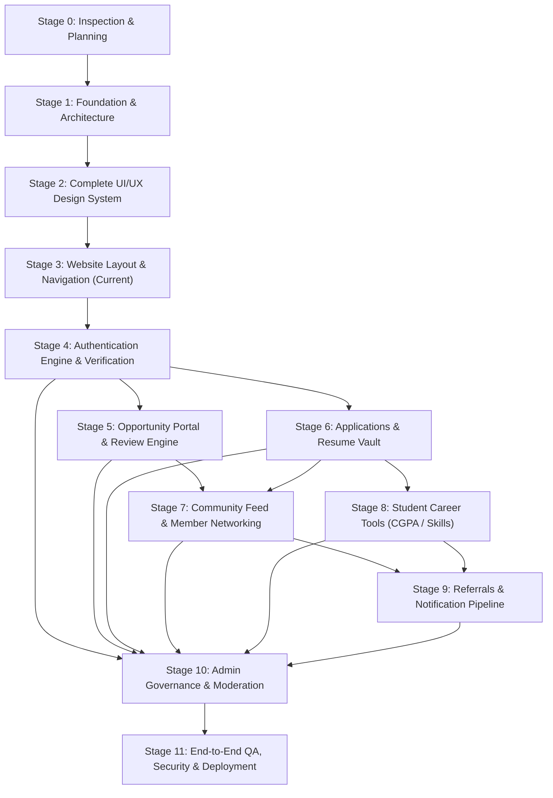

# UniCareer Community — Development Roadmap & Stage Dependency Matrix

## 1. Stage Dependency Graph

---

## 2. Stage Execution Log & Milestones

### Stage 0: Project Inspection & Planning
- **Status**: **COMPLETE** (2026-10-30)
- **Prerequisites**: None.
- **Core Deliverables Delivered**:
  - Environmental inspection and package stack verification.
  - 13 development skills installed and configured.
  - Git repository initialized.
  - 27-entity relational database ERD and comprehensive architectural contracts.
  - Complete living documentation system created in `docs/`.

### Stage 1: Project Foundation & Architecture
- **Status**: **COMPLETE** (2026-10-30)
- **Prerequisites**: Stage 0.
- **Core Deliverables Delivered**:
  - Next.js 16.4.3 (App Router) + React 19.3.0 + TypeScript 5.
  - Tailwind CSS v4 with `@tailwindcss/turbopack` and shadcn/ui components integration.
  - OKLCH University Navy / Royal Blue color tokens with Light, Dark, and System theme switching.
  - Shell layout with `AppNavbar`, `AppFooter`, `ThemeToggle`, `ErrorBoundary`, `GlobalError`, and `NotFound` pages.
  - Database connectivity established with PostgreSQL 16 via Prisma 7 & `@prisma/adapter-pg`.
  - Development and test scripts configured (`dev`, `build`, `start`, `lint`, `type-check`, `test`, `db:seed`, `db:generate`).
  - Unit tests verified using Vitest (5/5 passing).

### Stage 2: Complete UI/UX Design System
- **Status**: **COMPLETE** (2026-10-30)
- **Prerequisites**: Stage 1.
- **Core Deliverables Delivered**:
  - Full design tokens, OKLCH palette, Inter typography scale, and WCAG 2.1 AA contrast in `app/globals.css`.
  - Light, Dark, and System theme persistence with zero-cascading-render `ThemeToggle`.
  - 17 reusable UI primitives in `components/ui/` (buttons, forms, badges, dialogs, tables, tabs, toasts, skeletons).
  - 3 feedback micro-UIs in `components/feedback/` (`EmptyState`, `ErrorBanner`, `ConfirmDialog`).
  - 8 Opportunity domain components in `components/opportunities/` (`JobCard`, `CompanyCard`, `EmployerBadge`, `VerifiedBadge`, `MatchScoreIndicator`, `DeadlineIndicator`, `ApplicationStatusBadge`, `ApplicantSummaryCard`).
  - 7 Community domain components in `components/community/` (`CreatePostBox`, `FeedPostCard`, `ReactionButtons`, `MemberProfileCard`, `ConnectionButton`, `ReferralCard`, `CommentThread`).
  - Interactive Design System demonstration page at `/design-system`.
  - Automated component unit tests (7/7 passing).

### Stage 3: Website Layout & Navigation
- **Status**: **COMPLETE** (2026-10-30)
- **Prerequisites**: Stage 2.
- **Core Deliverables Delivered**:
  - **Shared Authenticated Shell**: Responsive desktop sidebar (`AppSidebar`), sticky header (`AppHeader`) with global search and notification drawer, and mobile bottom bar + off-canvas drawer (`MobileNav`).
  - **Public Gated Entry Layout**: `app/(public)/layout.tsx` wrapping welcome landing (`/`), mission background (`/about`), terms of service (`/terms`), and student data privacy statement (`/privacy`). Zero public leakage of member directories or job details.
  - **Distraction-Free Auth Shell**: `app/(auth)/layout.tsx` wrapping member login (`/login`), verified registration (`/register`), and password recovery (`/forgot-password`).
  - **6 Reusable Page Templates**: `DashboardTemplate`, `ListingTemplate`, `DetailsTemplate`, `FormTemplate`, `ProfileTemplate`, `AdminTemplate`.
  - **Authenticated Domain Views**: Full page implementations for `/dashboard`, `/feed`, `/opportunities`, `/opportunities/[id]`, `/opportunities/post`, `/community`, `/referrals`, `/applications`, `/career-tools`, `/contributions`, `/profile/me`, `/settings`, `/notifications`, `/admin`.
  - **Added UI Primitives**: `Label` and `Progress` components.
  - **Unit Testing**: Vitest test suite expanded to 11 passing tests.
  - **Production Build**: 24/24 static and partial prerendered routes compiled with Turbopack. Zero TypeScript or ESLint errors.

---

## 3. Next Stage Preview

### Stage 4: Authentication Engine, Accounts & Verification
- **Status**: Planned (Next)
- **Prerequisites**: Stage 3.
- **Core Deliverables**:
  - Server-side authentication integration (NextAuth / Better Auth) connected to PostgreSQL via Prisma.
  - Registration flows with role assignment (`STUDENT`, `ALUMNI`, `FACULTY`, `STAFF`, `EMPLOYER`, `EXTERNAL_CONNECTION`).
  - Institutional domain verification and email confirmation tokens.
  - Session management and role-based route middleware protection.
