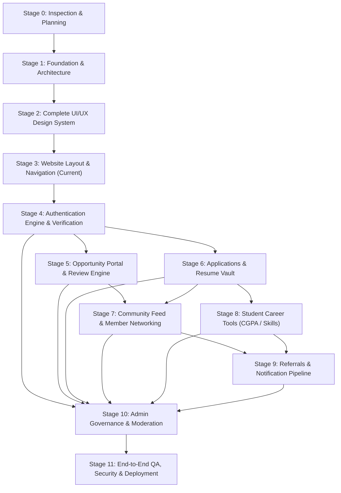

# UniCareer Community — Development Roadmap & Stage Dependency Matrix

## 1. Stage Dependency Graph

---

## 2. Stage Execution Log & Milestones

### Stage 0: Project Inspection & Planning
- **Status**: **COMPLETE** (2026-10-30)
- **Prerequisites**: None.
- **Core Deliverables Delivered**:
  - Environmental inspection and package stack verification.
  - 13 development skills installed and configured.
  - Git repository initialized.
  - 27-entity relational database ERD and comprehensive architectural contracts.
  - Complete living documentation system created in `docs/`.

### Stage 1: Project Foundation & Architecture
- **Status**: **COMPLETE** (2026-10-30)
- **Prerequisites**: Stage 0.
- **Core Deliverables Delivered**:
  - Next.js 16.4.3 (App Router) + React 19.3.0 + TypeScript 5.
  - Tailwind CSS v4 with `@tailwindcss/turbopack` and shadcn/ui components integration.
  - OKLCH University Navy / Royal Blue color tokens with Light, Dark, and System theme switching.
  - Shell layout with `AppNavbar`, `AppFooter`, `ThemeToggle`, `ErrorBoundary`, `GlobalError`, and `NotFound` pages.
  - Database connectivity established with PostgreSQL 16 via Prisma 7 & `@prisma/adapter-pg`.
  - Development and test scripts configured (`dev`, `build`, `start`, `lint`, `type-check`, `test`, `db:seed`, `db:generate`).
  - Unit tests verified using Vitest (5/5 passing).

### Stage 2: Complete UI/UX Design System
- **Status**: **COMPLETE** (2026-10-30)
- **Prerequisites**: Stage 1.
- **Core Deliverables Delivered**:
  - Full design tokens, OKLCH palette, Inter typography scale, and WCAG 2.1 AA contrast in `app/globals.css`.
  - Light, Dark, and System theme persistence with zero-cascading-render `ThemeToggle`.
  - 17 reusable UI primitives in `components/ui/` (buttons, forms, badges, dialogs, tables, tabs, toasts, skeletons).
  - 3 feedback micro-UIs in `components/feedback/` (`EmptyState`, `ErrorBanner`, `ConfirmDialog`).
  - 8 Opportunity domain components in `components/opportunities/` (`JobCard`, `CompanyCard`, `EmployerBadge`, `VerifiedBadge`, `MatchScoreIndicator`, `DeadlineIndicator`, `ApplicationStatusBadge`, `ApplicantSummaryCard`).
  - 7 Community domain components in `components/community/` (`CreatePostBox`, `FeedPostCard`, `ReactionButtons`, `MemberProfileCard`, `ConnectionButton`, `ReferralCard`, `CommentThread`).
  - Interactive Design System demonstration page at `/design-system`.
  - Automated component unit tests (7/7 passing).

### Stage 3: Website Layout & Navigation
- **Status**: **COMPLETE** (2026-10-30)
- **Prerequisites**: Stage 2.
- **Core Deliverables Delivered**:
  - **Shared Authenticated Shell**: Responsive desktop sidebar (`AppSidebar`), sticky header (`AppHeader`) with global search and notification drawer, and mobile bottom bar + off-canvas drawer (`MobileNav`).
  - **Public Gated Entry Layout**: `app/(public)/layout.tsx` wrapping welcome landing (`/`), mission background (`/about`), terms of service (`/terms`), and student data privacy statement (`/privacy`). Zero public leakage of member directories or job details.
  - **Distraction-Free Auth Shell**: `app/(auth)/layout.tsx` wrapping member login (`/login`), verified registration (`/register`), and password recovery (`/forgot-password`).
  - **6 Reusable Page Templates**: `DashboardTemplate`, `ListingTemplate`, `DetailsTemplate`, `FormTemplate`, `ProfileTemplate`, `AdminTemplate`.
  - **Authenticated Domain Views**: Full page implementations for `/dashboard`, `/feed`, `/opportunities`, `/opportunities/[id]`, `/opportunities/post`, `/community`, `/referrals`, `/applications`, `/career-tools`, `/contributions`, `/profile/me`, `/settings`, `/notifications`, `/admin`.
  - **Added UI Primitives**: `Label` and `Progress` components.
  - **Unit Testing**: Vitest test suite expanded to 11 passing tests.
  - **Production Build**: 24/24 static and partial prerendered routes compiled with Turbopack. Zero TypeScript or ESLint errors.

### Stage 4: Authentication Engine, Accounts & Verification
- **Status**: **COMPLETE** (2026-11-05)
- **Prerequisites**: Stage 3.
- **Core Deliverables Delivered**:
  - **Selected Authentication Core**: Better Auth 1.7.17 configured with Prisma 7 adapter (`@prisma/adapter-pg`) on PostgreSQL 16.
  - **Account Data Models (`prisma/schema.prisma`)**: `users`, `sessions`, `accounts`, `verifications` tables synced to PostgreSQL.
  - **Role & Membership Separation**: `membershipType` (`STUDENT`, `ALUMNI`, `FACULTY`, `STAFF`, `EMPLOYER`, `EXTERNAL_CONNECTION`) kept completely separate from `systemRole` (`MEMBER`, `MODERATOR`, `ADMIN`).
  - **Password Security**: Scrypt salted/hashed password storage in `accounts` table. Plaintext passwords never stored.
  - **Email Verification Pipeline**: Cryptographic verification token generation, token dispatch via development logger store (`lib/email.ts`), automated redemption at `/verify-email`.
  - **Password Reset Pipeline**: 30-minute cryptographic recovery token issuance and single-use password update at `/reset-password`.
  - **Two-Layer Route Protection**:
    - Network Edge Proxy (`proxy.ts`): 307 temporary redirects for unauthenticated requests on protected routes with preserved `callbackUrl`.
    - Server Component Layout Guard (`app/(dashboard)/layout.tsx`): Authenticates session against PostgreSQL, enforces account active status (`SUSPENDED`/`DEACTIVATED` rejection).
  - **Polished Authentication UX**: Fully functional client forms for Login, Multi-Role Registration, Forgot Password, Reset Password, and Email Verification with loading spinners and accessible error states.
  - **Interactive User Menu**: Integrated live session display with working `signOut()` action.
  - **Automated Testing**: 27/27 Vitest unit and integration tests passing. Clean Next.js 16 production build.

### Stage 5: Membership Verification & User Profiles Engine
- **Status**: **COMPLETE** (2026-11-05)
- **Prerequisites**: Stage 4.
- **Core Deliverables Delivered**:
  - **Decoupled Identity Models (`prisma/schema.prisma`)**: Integrated `Profile` and `MembershipRequest` models into PostgreSQL. Retained strict separation between institutional `MembershipType` and platform `SystemRole`.
  - **Role-Tailored Onboarding Flow (`/onboarding`)**: Dynamic multi-step onboarding tailored to `STUDENT`, `ALUMNI`, `FACULTY`, `STAFF`, `EMPLOYER`, and `EXTERNAL_CONNECTION` with instant validation and database submission.
  - **Verification Review & Admin Center (`/admin`)**: Fully functional administrative verification management interface displaying applicant claims and evidence with live Approve and Reject with mandatory reason workflows.
  - **Resubmission & Historical Audit**: Rejection reasons displayed clearly to members with one-click resubmission modal and multi-attempt historical tracking in `membership_requests`.
  - **Profile System & In-Place Editing (`/profile/me`)**: Live database-connected member profile with status badges, institutional dossier, skills, experience, projects, links, and responsive `EditProfileModal`.
  - **Strict Profile Privacy Redaction (`/profile/[id]`)**: `getPublicProfile` server service redacts sensitive Student IDs, personal phone numbers, and private emails for general community members.
  - **Server-Enforced Opportunity Posting Clearance (`lib/permissions.ts`)**: `canPostOpportunity` and `assertCanPostOpportunity` guarantee that unverified members cannot publish opportunities by altering frontend state.
  - **Automated Testing**: 42/42 Vitest unit and integration tests passing. Clean Next.js 16 production build.

### Stage 6: Companies, Opportunities, and Approval System
- **Status**: **COMPLETE** (2026-11-05)
- **Prerequisites**: Stage 5.
- **Core Deliverables Delivered**:
  - **Company Database Model & RBAC (`prisma/schema.prisma`)**: Integrated `Company` and `CompanyMember` models with role-based governance (`OWNER`, `ADMIN`, `MEMBER`) and granular capability flags (`canManageCompany`, `canPostOpportunities`). Creator is automatically assigned as company `OWNER`.
  - **Opportunity Model & Lifecycle**: Comprehensive `Opportunity` schema supporting 5 opportunity types (`INTERNSHIP`, `FULL_TIME`, `PART_TIME`, `CONTRACT`, `OTHER`), 2 provenance classifications (`OFFICIAL_EMPLOYER`, `COMMUNITY_SHARED`), 6 statuses (`DRAFT`, `PENDING`, `APPROVED`, `REJECTED`, `EXPIRED`, `CLOSED`), workplace types, application methods, minimum CGPA scale, academic year, and compensation.
  - **University Department Targeting**: Seeded 16 canonical Jagannath University departments into `departments` table. Supported department-specific targeting and `openToAllDepartments` filtering.
  - **Institutional Approval & Moderation System**: Server-side review queue (`getPendingOpportunities`, `reviewOpportunity`). Platform administrators evaluate opportunities with mandatory rejection feedback and permanent reviewer attribution.
  - **Anti-IDOR & Permission Assertion Services (`lib/services/`)**: `assertCanManageCompany`, `assertCanPostForCompany`, `assertCanModifyOpportunity`, and `createOpportunity` enforce server-side boundaries preventing unauthorized publishing, company editing, or unapproved posting discovery.
  - **REST API Suite (`app/api/`)**: Implemented `/api/companies`, `/api/companies/[id]`, `/api/companies/[id]/members`, `/api/departments`, `/api/opportunities`, `/api/opportunities/[id]`, `/api/opportunities/[id]/submit`, `/api/opportunities/[id]/close`, and `/api/admin/opportunities`.
  - **Interactive Admin Moderation UI (`components/admin/opportunity-review-table.tsx`)**: Live administrative review table integrated into `/admin` with modal dialogues for Approve and Reject with mandatory justification.
  - **Automated Testing**: 18 new unit and integration tests (60/60 passing across all 8 test files).
  - **Production Build**: 37 App Router routes compiled cleanly with Next.js Turbopack.

---

## 3. Next Stage Preview

### Stage 7: Opportunity Portal & Candidate Applications
- **Status**: Planned (Next)
- **Prerequisites**: Stage 6.
- **Core Deliverables**:
  - Member opportunity catalog browsing and filterable search interface (`/opportunities`).
  - Detailed opportunity view with company badge and provenance banner (`/opportunities/[id]`).
  - Opportunity creation wizard for verified members and company representatives (`/opportunities/post`).
  - Internal application submission with private resume vault upload.
  - Application lifecycle management (submission, withdrawal, employer candidate review).
